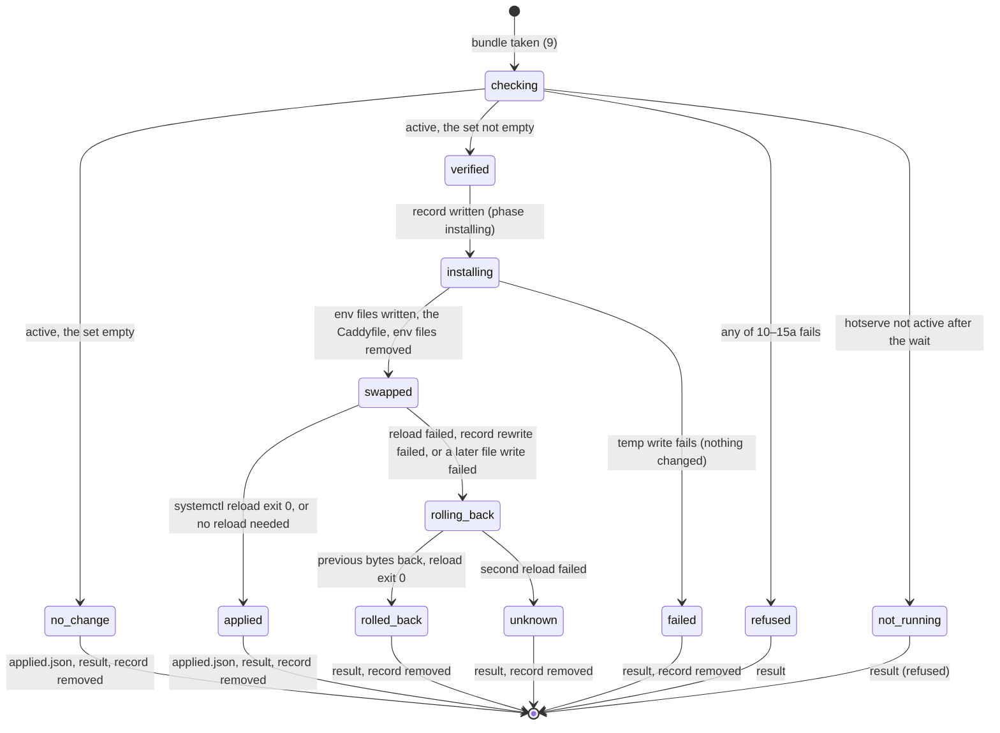
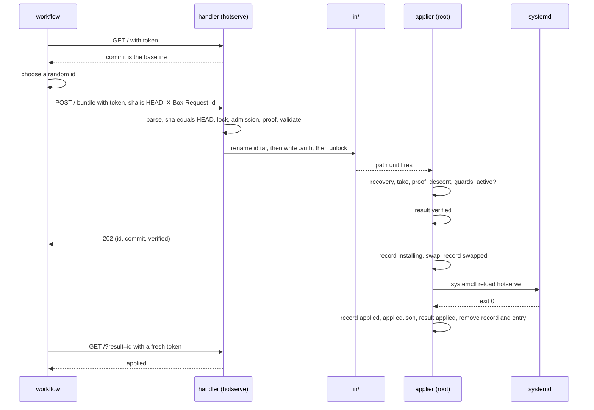
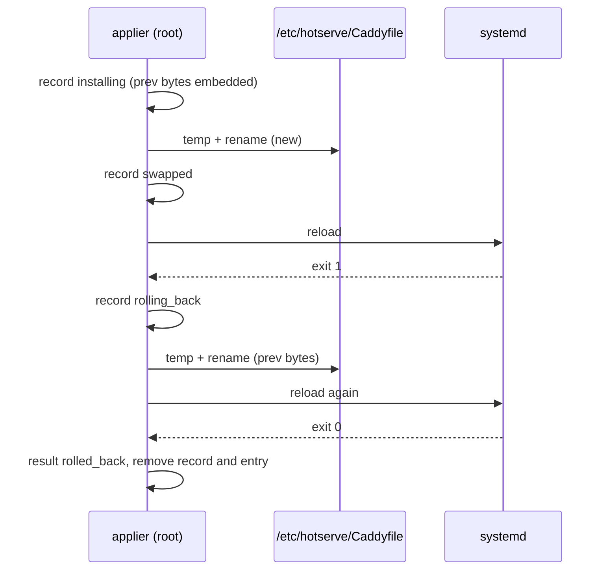
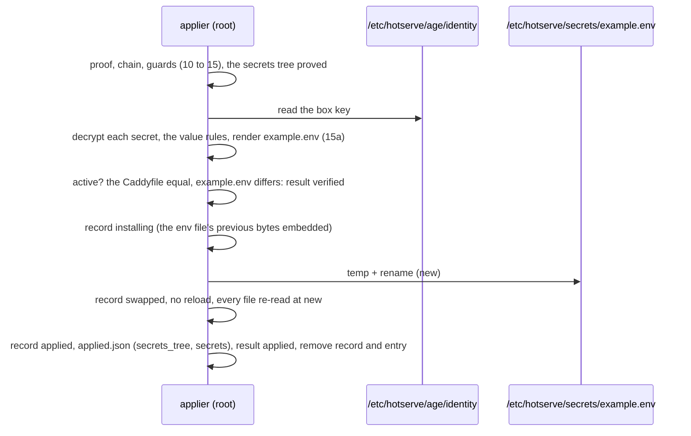

# DESIGN — box

This document describes the present: what is built, why, and what it
promises. History lives in git (`git log -- box/DESIGN-box.md`); the
"History" section at the end holds only dated one-liners. Amendments
are for decisions still fresh or contested and get folded into the
body once they settle.

**Status: built, and released**: the box channel in v0.3.0, and
secrets in v0.3.1 (the "Secrets" section, and every step, row and
message that names a secret, the box's key, an env file the box
writes or the set). History lists the PRs. Normative: a change that
cannot hold a line here changes the line in the same PR, with the
reason.

**Two rules of this document.** Every fact lives in exactly one table;
prose uses it and points to it, and never restates it, so a change
lands once. And the document specifies *invariants, states, durable
writes and messages*; the exhaustive crash cases are PR 3's
table-driven tests, which cite the invariants by id. The "Review
checklist" at the end is the set of questions a change to this file
must answer before it is pushed.

`box` is the subsystem that writes `/etc/hotserve/Caddyfile`, and the
apps' env files under `/etc/hotserve/secrets/` ("Secrets"). It is
not liveswap's: applying the whole file covers Caddy sites, the cache,
penaltybox and liveswap alike. It sits beside liveswap and penaltybox,
imports liveswap's deploy-trust verifier and env-file format (the
allowed direction), and owns four things: the `box` global option and
`box_webhook` site directive, the root applier unit, the box's key for
secrets, and `hotserve init` / `hotserve box …`. The wider attack surface it changes is in
[DESIGN-threat-model.md](../DESIGN-threat-model.md), "Config webhook"
and T6.

## Glossary

| Term | Means exactly |
|---|---|
| **bundle** | One gzip tarball the workflow POSTs: `path`, `Caddyfile`, `commit`, `parents/NNNN`, `trees/<sha>`, `blobs/<sha>` (the secrets' files, "Proving the secrets"), nothing else. |
| **secret** | One variable of one app: the file `<host>/secrets/<app>/<VAR>.age` in the repository, whose plaintext is exactly the value ("Layout in the repository"). |
| **box key** | The box's own age identity, `/etc/hotserve/age/identity`, and its recipient, `/etc/hotserve/age.pub` ("The box's key"). |
| **reader** | A key other than the box's that a secret is encrypted to, so a person can read it back and re-encrypt it: a recipient line of `recipients` after the box's. |
| **env file** | `/etc/hotserve/secrets/<app>.env`, rendered by root from an app's secrets (step 15a). "Env file" in this document means only these; one a person makes elsewhere is the operator's, and `box` never touches it. |
| **the set** | What one push writes: the Caddyfile, and each env file the push changes — written, rewritten or removed. A set with nothing in it is `no_change`. |
| **HEAD** | The commit the bundle is for: `sha1("commit <n>\0" + raw)` of the bundled `commit` object, computed, never read. |
| **baseline** | The commit the box runs: `sha` in `applied.json`. Advances only as the state machine says. |
| **chain** | HEAD plus the bundled `parents/` commits, first-parent from HEAD down to, not including, the baseline, each linked to the next by hash. HEAD is always on it, so the chain is never empty: whatever would write — root, and the handler's pre-verification before validate — checks HEAD's signature against the installed list, HEAD equal to the baseline included (then the chain is HEAD alone and `parents/` must be empty). The one answer given without it is step 4's `no_change` fast path, which writes nothing: HEAD is the baseline, the bundled bytes are the installed bytes, the secrets tree and the env files are as `applied.json` records them, and the bundle passes the steps that need no signature (path, file and secrets proofs, linkage). `parents/` is also empty when HEAD's first parent is the baseline. The cap counts HEAD. |
| **installed file** | `/etc/hotserve/Caddyfile` as root last wrote it. The source of the signer list and the rollback bytes. |
| **record** | `txn.json`: the one durable marker of a transaction in flight, with a `phase`. Present means "no terminal result yet". |
| **result** | `out/<id>.json`: what a push came to. Non-terminal: `verified`. Terminal: `refused`, `no_change`, `applied`, `failed`, `rolled_back`, `unknown`. |
| **marker** | `stage/<id>.auth`: the handler's note that a push with id `<id>` was admitted, holding the time it was. |
| **pending** | A push that blocks admission: a bundle in `in/`, or a marker younger than thirty minutes with no terminal result. See "Admission". (A result poll's answer for a marker with no result yet is `admitted`, whatever the marker's age.) |
| **id** | 32 lowercase hex the *workflow* chooses at random for each push and sends as `X-Box-Request-Id`, so it knows the id before it asks and a lost response loses nothing. Not a credential: a result poll is authenticated by `deploy_trust` like every request. Not an arrival order: the applier orders by the marker's `posted` time. |
| **active** | `systemctl is-active hotserve` says `active`. `activating` and `reloading` are waited out, within one wait budget per run (Caps); anything else is "not running". A push applies only on `active` (step 16). |
| **up** | How recovery and `init` classify the same question's answer, after the same wait: `active`, or still `reloading` — hotserve serves, and a reload queues behind the one in flight. Still `activating`, `inactive`, `failed`: not up. |

## Why this subsystem exists

The Caddyfile is where the box's policy lives: which repository may
deploy each app, each Deno app's permission flags, which hosts are
served, and — with this subsystem — who may change the file itself.
Before it, the file reached the box by a hand edit as root on day 0
and afterwards by `examples/box/bin/push`: a laptop script over SSH as
an administrator whose sudoers file allowed eight fixed commands. That
shape could not promise three things.

- **The change was whatever the laptop sent.** `bin/push` pushed the
  file beside it. Nothing tied the bytes to a commit, a review or a
  person; the README asked for "merge, then push from a checkout of
  main" as a ritual.
- **The administrator was a standing privileged account.** Eight
  sudoers lines, a group, an SSH key, and a "prove `sudo -n` works
  before you close root" step on page 2 of the tutorial. Secrets rode
  the same account (`sudoedit`).
- **The box could not be told who it belonged to.** A compromised
  laptop, a leaked GitHub token or an OAuth app with `contents:write`
  all had routes to the file, and the box had no way to tell them from
  the operator.

With `box`, the file is written in exactly one place — a private
repository of the operator's — and the box applies a commit only if
(a) a token proves it came from that repository's `main` workflow,
(b) an SSH key the box lists signed the commit and every commit on the
chain, (c) the file sent is the file in that commit, and (d) the
commit descends from the one the box runs. The apps' secrets ride the
same commits, encrypted on a laptop to the box's own key and checked
by the same chain ("Secrets"), so no account on the box is needed to
edit them either. On the normal path root is
used twice in a box's life: to install the package and start it, and to tell the
box which repository it belongs to. The console stays the way back —
a rewritten history (`hotserve box baseline`), a renamed deploy host
(`init` again), a config that broke the webhook site
itself ("At 3am") — and nothing here promises that it is never needed
again.

## The shape

The repository holds one directory per box, named for its deploy host;
the box is one file, and its apps' secrets beside it:

```
deploy.example.com/Caddyfile   # the whole config
deploy.example.com/secrets/    # the apps' secrets, encrypted: "Secrets"
.github/workflows/apply.yml    # validates every push and PR; applies main to the box
Makefile                       # make signer, make check, make wip, make secret …
bin/                           # what the Makefile and the workflow run
```

The Caddyfile's global options carry a `box` block beside `admin`, and
exactly one site carries `box_webhook`:

```
{
	admin unix//run/hotserve/admin.sock

	box {
		deploy_trust github {
			audience hotserve
			claim repository your-org/boxes
			claim ref refs/heads/main
		}
		# signers
		signer alice@example.com ssh-ed25519 AAAAC3Nz…
	}

	liveswap { … }
}

example.com { reverse_proxy { dynamic liveswap example } }

deploy.example.com {
	liveswap_webhook     # deploys: POST /<app>
	box_webhook          # this file: POST / from the workflow
}
```

- `deploy_trust` is liveswap's grammar and verifier, unchanged
  (`deploytrust.Parse` and `Limiter.Authenticate`,
  liveswap/deploytrust/): GitHub, GitLab, generic OIDC and the local
  key come for free, and the flat 401 and the `refused` journal line
  are the same shape as a deploy's. A `box` token must carry a
  `sha` claim (GitHub's does; `hotserve deploy-token --claims sha=…`
  mints one); a source that cannot supply it is refused by name.
- `signer <principal> <key-type> <base64>` is one person's SSH public
  key. The principal matches `^[A-Za-z0-9._@+-]+$` and nothing else
  (allowed_signers principals are patterns with `*`, `?`, `!` and `,`;
  none may appear). Key types: `ssh-ed25519`, `ecdsa-sha2-nistp256/
  384/521`, `sk-ssh-ed25519@openssh.com`,
  `sk-ecdsa-sha2-nistp256@openssh.com`, `ssh-rsa`. The base64 must
  decode to a key of the declared type and be that key's one canonical
  line (the decoder forgives a newline inside a quoted token; the
  allowed_signers file would not). The principal is at most 256 bytes.
- `box_webhook` takes no arguments and no matcher: a matcher is an
  argument to Caddy, and `box_webhook /hook` would adapt and leave `/`
  unserved, so the directive's parser and the walk both refuse one by
  name. It handles exactly the path `/`
  (with or without `?result=`) and passes every other path to the next
  handler. It must run before `liveswap_webhook`, which is terminal on
  every path it sees, and Caddy's `RegisterDirectiveOrder` can only
  anchor on a *standard* directive (it panics otherwise) and inserts
  immediately before the anchor — so anchoring on `reverse_proxy`, as
  liveswap does, would place `box_webhook` *after* `liveswap_webhook`
  and the channel would be dead. `box_webhook` is therefore anchored
  `Before, "redir"`, a standard directive earlier than `reverse_proxy`,
  and a unit test adapts the example Caddyfile and asserts the route
  order. The site
  that carries it has exactly one address, a bare hostname: no scheme,
  port, path, wildcard, placeholder or second name. That hostname is
  the address the workflow posts to, the box's identity, and the name of
  the file's directory (see "The box's identity").
- The signed file is the whole configuration. It contains no `import`,
  every site block is braced, and no token at directive position, in a
  site address or inside the `box` block contains `{$`. Placeholders
  stay legal in values. See "Reading the signed file" for why each
  rule exists and what it does and does not guarantee.

## The trust chain (normative)

A step that fails stops the chain; the installed file is unchanged;
the result carries the message from the catalogue. Numbers are used as
cross-references throughout.

**In the hotserve process (the `box_webhook` handler, uid hotserve):**

1. **Token.** `Authorization: Bearer <JWT>` is verified against the
   `box` block's `deploy_trust` sources through the one exported
   liveswap entry point both handlers call, `Limiter.Authenticate`
   (liveswap/deploytrust/), which returns an `Identity` — the
   attribution string and, behind `Identity.Claim`, the verified
   claims — or the `Refusal` the handler writes. The flat 401, the
   failure budgets (which bound the journal, never the answer), the
   `webhook auth failed` line with
   `refused` and the `could not consult a trust source` line are
   liveswap's; the budgets are shared across both webhooks.
2. **Admission.** See "Admission". The request id (400) and the media
   type (415) are checked before the body is read, the body's size
   (413) as it is read; then steps 3 and 4 and the fast path run on the
   body in memory, before the lock, so a slow upload never holds it
   — under the process's one push slot (Caps, "pushes in memory").
   Only then is the admission lock taken and the pending and `in/`
   checks run; a request that does not pass is 409 with nothing
   written.
3. **Bundle.** Parsed from memory under the rules in the Caps table:
   regular files only, fixed names, per-type caps, the decompressed
   stream stopped at its cap. The same parser runs in the applier.
4. **Token ↔ bundle.** The token's `sha` claim must equal HEAD. This
   binds the bundle to the commit the run is for; without it any
   signed descendant of the baseline, a signer's unmerged branch tip
   included, would pass steps 11 to 13. This check is the handler's
   alone: the token is not in the bundle, and root cannot verify an
   OIDC token offline. Its absence from root's checks is T5's reach
   through root; see "Threat-model deltas". **Fast path, here and not
   earlier:** once the token, the request-id header (step 2) and this
   binding have passed — and the id is not one the box already holds,
   which is asked before the body is read (a marker, a result, or a
   bundle still in `in/`: 409 "duplicate request id", so one id is never
   answered two ways) — if HEAD equals the baseline, the bundled
   file's digest equals the installed file's, the bundle's secrets tree
   is the one `applied.json` records, its apps are exactly the ones
   `applied.json` lists, and every env file `applied.json`
   lists reads back with its recorded digest, at the mode and owner root
   writes (one that cannot be read, or whose mode or owner drifted,
   counts as changed, never as an error: root writes it again), and the bundle passes the
   steps that need no signature (11's path is the one `applied.json`
   records, 13's file and secrets proofs, 14's linkage with `parents/`
   empty), nothing on disk would change, so the handler answers 200 `no_change`
   with no admission lock, no drop and no root work (asked again under
   the lock, of what was read there, so a push another one applied
   meanwhile is answered the same way) — it skips only the work that
   would write. No signature is checked: HEAD's id is the baseline's,
   so its bytes are the commit the box already runs. A bundle that
   fails any of those steps goes on to pre-verification, which refuses
   it by the step's name, so a shape root refuses is never answered
   `no_change`. An OIDC holder posting the applied `HEAD` in a loop
   learns what `GET /` and the slow path's refusals already tell it; a
   token without the right `sha`, or a POST without its id, is refused
   as it would be on the slow path. The fast path writes nothing, not
   even a marker: a poll of its id finds none (404), and the 200 is the
   whole answer. (After a console edit of the Caddyfile or an env file,
   or the loss of an env file, the digests differ and the push goes to
   root, which reinstalls HEAD's files by design; the next replay takes
   the fast path again.)
5. **Pre-verification.** The handler runs the applier's proof code
   (steps 10 to 13) before anything touches the staged file, so a
   signed commit paired with other Caddyfile bytes fails here and
   validate only ever sees bytes a listed signer committed. The shared
   verifier takes the uid to run `ssh-keygen` as, 0 meaning "as I am";
   the handler passes 0 and uses `hotserve.service`'s own `PrivateTmp`.
   A courtesy, not the boundary: root repeats every check.
6. **Validate.** `/usr/bin/hotserve validate --adapter caddyfile
   --config <staged file>` as a child bounded per the Caps table, with
   the service's own environment, and `/usr/bin/hotserve-backup validate <file>` when
   that binary is executable — `test -x`'s question, `access(X_OK)`: no
   file, one this uid cannot run, or a path through a non-directory is
   "not installed"; any other failure is the box's error, a 500 ("could
   not ask whether backups are installed"). A child that exits non-zero, or outlives its deadline, refuses the
   push; one that cannot start, or that another signal killed (the OOM
   killer), is the box's error, a 500. Output reaches the
   response and the journal only through liveswap's redactor primed
   with that environment, less the variables systemd and the login
   shell set for every service (`USER`, `HOME`, `PATH`, `LC_*`,
   `XDG_*`, the `*_DIRECTORY` paths and the rest of systemd.exec(5)'s
   list): those are the box's own words, which a diagnostic needs. Root never runs either: `caddy validate`
   provisions every module and the adapter expands `{$VAR}` from the
   caller's environment and runs each module's parser on the input.
   The same step reads the file's adaptation (`hotserve adapt
   --adapter caddyfile --config <staged file>`, a third child bounded
   per the Caps table, whose JSON leaves the handler as nothing but a
   verdict) for **reachability**: a `GET` and a `POST` for `/` on the
   `box_webhook` host must meet `box_webhook` before any handler that
   can answer them — not an `order` option, not a second site for that
   host (`host/*`, which Caddy sorts ahead), not anything else. What may
   stand in front, and how a matcher is decided, are the "Reachability"
   tables; a push that fails them is refused by the handler's name. Like
   the rest of this step it is a courtesy against a signer's mistake,
   not a boundary: root never adapts, so step 15 checks presence alone.
   Last, the secrets' consistency checks, on the token walk of the
   staged file and the bundle's secrets tree, never on the adaptation:
   an app's secrets and its `env_file` line must agree ("Which checks
   run where"). Also a courtesy; root does not repeat them.
7. **Drop.** The bundle, assembled in `stage/`, is renamed into `in/`
   as `<id>.tar`; only then is the marker written with the time (see
   "Admission" for why in that order); then the admission lock is released. The handler logs `box
   push accepted` with `id`, `commit`, `via` and `remote`. Nothing about
   the caller is handed to root.
8. **Answer.** The handler polls `out/` every second for at most 30 s
   and answers by the first phase it sees, per the Handler contract
   table: `verified` → 202 `{id, commit, phase}`; `no_change` or
   `applied` → 200 with the result; `refused`, `failed`, `rolled_back`
   or `unknown` → 422 with the result (a fast transaction can be
   terminal before the first poll, and a red outcome is never carried
   by a 2xx); nothing yet → 504 `{id}`. The workflow already holds the
   id, so a lost response, whichever status it carried, is recovered by
   `GET /?result=<id>` with a fresh token. The handler never waits past
   the first result ("Why 202 and a poll").

**In the applier (`hotserve box apply`, root, one shot, path-triggered):**

9. **Recover, then take.** Under root's blocking lock the applier
   first settles anything a crash left (the "Recovery" column of the
   States table and the Failure-mode table), then renames every entry
   of `in/` into `work/` — whatever it is; `CAP_DAC_OVERRIDE` and
   `CAP_FOWNER` exist so that nothing the hotserve uid creates can
   stay. An entry whose name is not `<id>.tar`, or which is not a
   regular file, has no legal result name: it is removed with an
   error-level journal line and no result. The rest are processed in
   order of their markers' `posted` time (an entry with no readable
   marker goes last). A push settles once: a bundle whose id already
   has a terminal result (on disk, or journaled by this run; a result
   that does not read, or whose phase is not terminal, counts as none —
   out/ is root's alone, so only a disk fault or the console makes a bad
   one) — back in `in/` after a power loss beat
   the durability of its unlink, or replayed by the hotserve uid — is
   removed with a warning and never run again, for as long as Retention
   keeps that result; a take that fails writes no `failed` over it. A
   result journaled in an earlier run, never written, protects nothing
   (I3's exception): its push may run again. The order
   decides only which pending bundle is tried first, the descent check
   decides each outcome. Each bundle is
   opened `O_NOFOLLOW|O_NONBLOCK`, checked `S_ISREG`, read once through
   a reader that stops at the cap plus one byte, and never touched on
   disk again: a writer holding a descriptor from before the rename
   cannot change what was verified, because nothing is verified from
   disk.
10. **The installed file.** Read once into a buffer that is both the
    signer list's source and the rollback bytes. Signers come from the
    raw token stream (see "Reading the signed file"), never from the
    running configuration and never from an imported file. An empty
    list refuses. The out-of-band flag — installed digest ≠
    `applied.json`'s `sha256` — is computed here and stored in the
    record.
11. **Identity.** The incoming file's `box_webhook` hostname equals the
    installed file's, and the bundle's `path` equals the path in
    `applied.json`. See "The box's identity".
12. **Signature.** The commit's `gpgsig` is an SSH signature over the
    commit object with that header removed (git's rule, continuation
    lines included). An allowed_signers file is generated from the
    installed signers (`<principal> namespaces="git" <type> <base64>`).
    Which listed key signed is the box's own decision: the SSHSIG blob
    carries its public key, matched byte for byte against the list, so
    "unlisted" never depends on ssh-keygen's exit status; the blob's
    namespace must be `git`, refused by name otherwise. Then
    `ssh-keygen -Y verify -n git -I <principal>` runs as uid 65534 with
    an environment of `PATH` alone, the payload on stdin; its exit
    status is the verdict — but that status is the same for "the
    signature is wrong" and "I could not read my files", so a failure
    counts as a verdict only when a built-in control signature (a
    throwaway key's, over a fixed payload; public half and signature
    only) verifies in the same run, as the same uid, in the same
    directory. Control verified, push not: the signature does not
    verify over the commit — altered after signing, or made with a
    form of key this ssh-keygen will not take — which is the push's
    problem. Neither verified: the box's error, never a refusal. A
    signer line ssh-keygen would refuse to read (an RSA key under its
    1024-bit floor) is refused by `init` and the walk, so a list the
    box accepts is one ssh-keygen accepts.
    No `gpgsig`, an OpenPGP `gpgsig`, a `gpgsig` of neither kind or one
    the box cannot read, a `gpgsig-sha256`, an unlisted key, and an
    altered commit each refuse by name.
13. **The file is the committed file.** The root tree's id equals the
    commit's `tree`; the `path`'s components are walked through the
    bundled trees (depth per the Caps table); the last entry is a blob
    (`100644`/`100755`) whose id is `sha1("blob <n>\0" + file)`. A
    symlink, submodule or tree at the path refuses; a SHA-256
    repository refuses. Plain `crypto/sha1`, not sha1dc, is an accepted
    residual. **And the secrets are the committed secrets:** from the
    file's directory the walk looks up `secrets`, and every entry under
    it is held to the layout and proved, every `.age` file's blob
    bundled and hashed ("Proving the secrets").
14. **Descent, every step signed.** The chain is walked first-parent
    from HEAD, linked by hash: `parents/0001`'s id equals HEAD's first
    `parent` header, each next entry's id equals the previous entry's
    first `parent` header, and the walk ends at a header equal to the
    baseline (whose object is not bundled). An unreferenced entry, a
    gap, or an entry past the end is a malformed bundle. The chain
    reaches the baseline within the cap, and **every commit on it
    carries a signature step 12 accepts**: otherwise an unsigned commit
    pushed by a leaked credential would ride in under the next signed
    one. HEAD equal to the baseline is a chain of HEAD alone (see the
    Glossary): root still checks its signature, no parent may be
    bundled, and step 16 decides whether anything changes (the
    handler's step-4 fast path has already answered the case where
    nothing would). A history longer than the cap fills the chain
    exactly and still names a parent: that is the cap's refusal, not
    the descent one. A commit
    between the baseline and HEAD is refused by what its verdict was —
    unsigned, listed-but-unverifiable (its own message), or signed by a
    key the box did not list when it last applied, named by the
    principal the *incoming* file gives that key, or "not in the new
    Caddyfile either". A verifier that could not answer (ssh-keygen
    could not run, the chain deadline passed) is the box's error, never
    a refusal. What this rule does and does not stop is in "The merge
    button" and "Threat-model deltas".
15. **Never cut the branch you sit on.** The incoming file has a `box`
    block with at least one `signer` and a `deploy_trust` block with at
    least one line (token-level presence; root runs no directive
    parser), exactly one site carrying `box_webhook`, and still lists
    the key that verified HEAD. Rotation is therefore two *applied*
    pushes. This guard checks presence, not reachability: reachability
    is the handler's (step 6), which root cannot repeat; the console is
    the guarantee behind both.

    15a. **Decrypt (root only).** Only now, every proof and every
    signature on the chain passed, root reads the box key and decrypts
    each secret, holds the values to the rules of "Values and the env
    file", and renders each app's env file in memory. A secret not
    encrypted to this box's key, a value the env-file format cannot
    hold, or a cap exceeded refuses; a missing key or a directory not
    as tmpfiles.d makes it is the box's error, `failed`. A HEAD with no
    secret reads no key, so a box without one applies every push that
    carries none, removals of listed env files included. The handler
    never runs this step: it cannot read the key (I6, I9).
16. **Install or not.** From here the state machine governs: active?
    changed — the Caddyfile, or any env file? See "The install
    transaction".

Steps 10 to 15 are one function the handler's pre-verification (step
5) and the applier share, run cheapest first: the two files' readings
and the identity (10, 11 and 15's presence rules), the file proof
(13), the chain's linkage (14), then every signature on the chain,
HEAD's first (12 and 14), then 15's key guard — so a malformed bundle
never starts `ssh-keygen`, and when more than one step would refuse,
the first so found is the one named. Step 15a follows, in the applier
alone, so no secret is decrypted for a bundle any of them refuses.
Step 16 waits out `reloading` as
it does `activating` — a reload in flight, the console's or one a
killed applier started, ends in `active` or a failure — within one
budget per run: 300 s from the run's first sight of either, so the
waiting in a run is that long, plus one is-active question (bounded at
30 s) per ask, whatever hotserve does. The accepted cost: a later
episode in the same run, once the budget is spent — after recovery
waited out a boot, say — gets no wait, so its push is refused as still
starting and the workflow's run fails; a re-run pushes again. After the wait, one classification serves every caller:
hotserve is *up* when it is `active` or still `reloading` (a reload
then queues behind the one in flight); `activating` (a start, or a
restart loop, which reads the file on disk when it gets there) and
every other word is not running. A push is refused on anything but
`active`, with the "still starting" text after a wait that timed out.
`init` asks once, when it begins (after its recovery, whose wait may
have spent the run's budget), and refuses, writing nothing, on anything
but up; the residual is a hotserve that stops after `init` found it up,
which ends `unknown`, both reloads refused. The installed file failing the
walk for a reason other than an empty signer list, `applied.json`
missing or unreadable, `ssh-keygen` unable to answer and `is-active`
unanswered are the box's errors: `failed`, never `refused`
(Transitions table, "checking → failed").

**`init`'s path through the chain.** `init` is the console seeding or
re-seeding the box's identity, baseline and signers, so steps 10 to 15
— every comparison against the installed file and `applied.json` —
do not apply to it: on a fresh box there is no `applied.json` and the
packaged Caddyfile has no `box` block, and on a rebind the new host is
the point. `init` runs "Reading the signed file" on the incoming file
(the structural refusals: `box` block, signers, `deploy_trust`, one
bare-hostname `box_webhook` site, no `import`, no placeholder at a
directive position, braces) and no validate: the reload is the check
(see "`hotserve init`"). Under root's lock, after recovery, it asks
step 16's question once, and on a hotserve that is up enters the state
machine at the buffer comparison with `origin: init`, writing
`applied.json` from its argument, the path it derives from the host
("The box's identity") and the bytes it installed. Its authority is
root at the console; the file it installs is the new "installed file"
every later push is checked against. `init` installs no secrets: it
has no objects to prove them against, so steps 13's secrets proof and
15a do not run, its set is the Caddyfile alone, and `applied.json`'s
`secrets_tree` and `secrets` are kept from the file it replaces (none
on a fresh box), so the first push decides the env files by the full
chain.

Running apps are never restarted by an apply, as with any reload
(liveswap's "reload trap"): a changed `app` block, and a changed env
file, apply at the app's next launch. A push that changes env files
and not the Caddyfile reloads nothing: an app's environment comes from
its env file only when hotserve launches it (`readEnvFile` in
`buildEnvFull`, liveswap/app.go), and loading a configuration only
checks the file's mode (`warnEnvFileMode`, a `stat`), so a reload
would change nothing an app sees.

### Why 202 and a poll

Root's part of a push (its chain's verification, hotserve's reload,
its wait when it finds hotserve `activating`) can run for minutes at
worst (Caps), and a request held open that long is one a proxy in
front of the box may cut. So the handler waits for the first result
only as long as Caps allows and answers by it (step 8), the applier
publishes `verified` before it installs and does not wait to be read,
and the workflow asks `GET /?result=<id>` — a fresh request with a
fresh token, served by whichever configuration runs — until the phase
is terminal. The poll is also how the workflow asks after a POST whose
answer it did not get, which is why the workflow, not the box, chooses
the id. A push of the commit the box already runs is answered 200
`no_change` by the handler's fast path. The handler's own steps before
the drop are held in the POST, each bounded by its Caps row; no
deadline covers the whole request, because the workflow answers a
proxy that cuts it either way: before the drop by sending the push
again under its id (409 duplicate if the box has it), after it by the
poll.

The protocol does not depend on what a reload does to a request in
flight, though one can be: the POST may still be in step 8's wait when
the applier, or anything else, reloads. On Caddy v2.11.7 a reload
leaves it alone. `hotserve reload` posts to the admin API, which runs
the new configuration and then stops the old one;
`caddyhttp.App.stop` starts each old server's `Shutdown` and waits for
it to finish only `if exiting`, which a reload is not. The request's
context comes from the `http.Server`, not from the configuration being
unloaded, and `box_webhook` has no `Cleanup`, so the old handler goes
on polling `out/` and answers. Measured once in the e2e box
(2026-10-11, a run outside the lane, over HTTP/1.1 and HTTP/2): with a
POST waiting in step 8 (the path unit stopped, so its bundle stayed in
`in/`), `systemctl reload hotserve` returned in 67–68 ms; the reloaded
configuration answered a fresh request; then, with the path unit
started, the applier ran and reloaded again, and the same POST was
answered `200 applied`, having outlived both reloads. Were a reload
ever to wait for in-flight requests, it would wait for the handler's
answer: within a poll interval of `verified` for the applier's own
reload, and up to the handler's whole wait for any other.

### Reachability: what may stand before `box_webhook`

The question step 6 asks of the adaptation: for a `GET` and for a
`POST` of `https://<host>/` — the host the walk found, no query, no
header a matcher could read — does the request meet `box_webhook`
before anything that could answer it. The handler takes the server
that holds the box site's route, walks that server's routes in order
and, inside each route that may match, its handlers in order,
recursing into a `subroute` (a site, `handle`, `route` and
`handle_path` all adapt to one). The first handler met decides, per
the first table: `box_webhook` is reached; a handler that passes is
stepped over; any other refuses the push. A route marked `terminal`
that may match and runs out of handlers answers too (Caddy hands the
rest of the chain an empty handler), so an empty `host/` site is "an
earlier site for `<host>` answers first". `handle` blocks share a
group: once one member has matched, Caddy skips the later members, and
so does this walk — a member under a route decided per request
satisfies its group only as far as that route does, since Caddy's
group map is one per request across nesting.

| Handler (module) | Treated as | Why |
|---|---|---|
| `box_webhook` | reached | |
| `subroute` | recursed, its routes in order | a site, `handle`, `route` and `handle_path` adapt to one |
| `vars`, `map`, `log_append`, `tracing`, `request_body`, `timeouts`, `encode`, `push`, `headers` without a `request` section, `hint_penaltybox` | passes | the request reaches the next handler as sent and its answer comes back with the status and body it wrote: the first four touch only variables, a log field or a trace span; `headers` here edits response headers, never the status or the body the workflow reads; `request_body` and `timeouts` bound the read; `encode` compresses what the client asked for, `push` adds HTTP/2 pushes; `hint_penaltybox` answers 429 only to a client in its box, which the workflow reports red with its status and body: `box_webhook` itself never answers 429 |
| `rewrite`; `headers` with a `request` section | refused: `<handler> changes the request first` | `rewrite` (also `uri`, `try_files` and `handle_path`'s strip) moves `/` away before `box_webhook` sees it; `request_header -Authorization` turns every push into a 401 with nothing in the answer to say why |
| anything else — `static_response`, `reverse_proxy`, `file_server`, `error`, `authentication`, `acme_server`, `metrics`, `invoke`, `intercept`, `templates`, `liveswap_webhook`, a handler this table does not list | refused: `<handler> answers first` | fail-closed: a handler the table has not weighed is one that may answer; `invoke`'s named route is not followed; `intercept` lets `box_webhook` run and then replaces its answer with its own `handle_response`, and `templates` renders whatever types it is told to (`mime application/json` included) over a body whose `diff` is bundle-derived text — so the workflow never sees the result it is told to poll |

The standard directives Caddy orders before `box_webhook` (`tracing`,
`map`, `vars`, `fs`, `root`, `log_append`, `log_skip`, `log_name`,
`header`, `request_body`, `timeouts`) all adapt to the "passes" row, so
a box site refuses nothing unless an `order` global option moves a
directive ahead. The sites Caddy sorts ahead of a bare hostname
(longer host first, then longer path, wildcard hosts after exact ones)
are those with the same host and a path, `host/*`; a second block
naming the bare host is "ambiguous site definition" to the adapter,
which validate refuses first, while one naming it with its port
(`host:443`) is another address string for the same host matcher,
sorted by file order — ahead of the box site when written before it.

| Matcher on a route | Decided |
|---|---|
| none | matches |
| `host`, `path`, `method`, `protocol` for `http`, `https` and `grpc`, and `not` over these, no placeholder in a pattern | statically, by Caddy's own matcher types, for the `GET` and for the `POST`: a request over TLS, no body, no header worth a matcher. A `protocol` naming an HTTP version (`http/2`, `http/1.1+`) is the connection's to decide, so "may" |
| `header`, `header_regexp`, `query`, `path_regexp`, `vars`, `vars_regexp`, `tls`, `remote_ip`, `client_ip`, `protocol` naming an HTTP version, `not` over these, or a pattern holding a placeholder | per request and never failing, so "may match": a refused handler behind it refuses the push as `<handler> may answer first (its <matcher> matcher is decided per request)`; a passing handler behind it passes. (`remote_ip` and `client_ip` fail only while a TLS handshake is incomplete: 0-RTT early data, which a push never sends.) |
| `expression`, `file`, `not` over these, a matcher this table does not list | per request and able to fail — Caddy answers the matcher's error and routes no further — so whatever stands behind it, the push is refused `the <matcher> matcher ahead of it may fail (decided per request)`. Within one set Caddy runs matchers in an order fixed only at load, so one that may fail counts whatever the others say; sets run in order until one matches, so a set that matches for sure shields the sets after it |

A matcher set matches when every matcher in it does, a route when any
of its sets does, and "may" sits between the two. `box_webhook` met
under "may" is not reached: the requests the matcher turns away run on
to whatever follows. The cost of "may": a
`header`- or `expression`-matched responder ahead of `box_webhook` on
`/` is refused even when it would never fire for the workflow; the
remedy is to move it behind `box_webhook`, where the default order
already puts every responder, or to give it a path.

Not caught here, by design. `init` runs no pre-check (the reload is the
check, and a reload loads an unreachable `/` as happily as any other),
so a file `init` installs that serves `/` first is found by the first
push, which meets the front handler's answer instead of this one's;
the console is the way back ("At 3am"), and whether the workflow asks
`GET /` for this handler's status before it posts is the template's
call. A `request_body` cap below the bundle's 16 MiB, or a `timeouts`
read deadline shorter than the upload, ahead of `box_webhook` is not
caught either: the push reaches the handler and fails its body read
(400), which names the bundle. Nor is anything that refuses the
connection before a route runs: the walk reads each server's routes,
not its TLS connection policies (a required client certificate), its
listener wrappers (`proxy_protocol`) or its `protocols`, so a signed
push that sets one the workflow's connection cannot pass strands the
box until root undoes it ("At 3am").

## The install transaction

### Invariants

Every transition below preserves all of these; PR 3's tests cite them
by id.

| Id | Invariant |
|---|---|
| **I1** | For every write the applier or `init` makes: `/etc/hotserve/Caddyfile` exists at every instant and is a complete file written whole — one that ran, or one whose reload is pending or in progress under a record that says `swapped`; a failed reload puts the previous bytes back, and a crash leaves a record saying which. The console is root and may write anything; the applier detects such a write by digest (step 10, and the re-reads the Transitions table gives) and reports it, and never overwrites it knowingly. A baseline names bytes that stand on disk when it is written: ones the transaction installed, or — for `no_change` — ones already there, which a console may have put there (Accepted residuals). Every env file in the set is likewise, at every instant, either absent or a complete file written whole — its previous bytes or its new ones — and the record says which each should be. |
| **I2** | Every entry the applier *listed* in `in/` leaves `in/` in that run (a bundle landing after the last listing is the next run's), and `work/` is empty and no record remains on every exit, except a run that stops with work on disk: the full-disk end of the Failure-mode table; a stop with everything left as found (a record that does not read, the installed file unreadable mid-transaction, `is-active` unanswered in recovery); and a filesystem error the run cannot work around (root's lock, a listing of `in/` or `work/`, an entry that can be neither taken nor removed, an entry or the record that cannot be removed). What such a run took stays in `work/`, and it ends with the line `box apply leaves work on disk` and the console's remedy ("The applier unit"). `in/` receives nothing but a complete bundle by one `rename`. |
| **I3** | Every bundle the applier takes ends in exactly one terminal result, or — only when the result cannot be written — one error-level journal line carrying every field the result would have; an entry that is not a bundle gets the journal line only, and a bundle whose push already settled (step 9) a warning line only — or, if its take fails, the take's error line. |
| **I4** | The baseline advances only from a transaction — the applier's or `init`'s — whose durable record says `applied` (reload confirmed) or `no_change` (hotserve found active; for `init`, up), or from `baseline`; each holds root's lock; it never runs ahead of the record. |
| **I5** | Within a transaction: from the first write that changes `/etc/hotserve` or `applied.json` until the terminal result, the record exists; it is written atomically before that first write and is the last thing removed. Refusals and `verified` precede it and write none. `hotserve box baseline` is not a transaction: one atomic write of `applied.json` under the lock, after recovery, with no record — a crash before its rename changed nothing, after it the reset is done; a retry is idempotent. |
| **I6** | Root installs nothing a listed signer did not sign (every chain commit), nothing that fails the file proof, nothing that does not descend from the baseline, nothing for another host or path. It decrypts nothing whose blob a proved tree does not name, and nothing before every signature on the chain has verified (step 15a). |
| **I7** | No pending outlives its bound: a marker stops blocking admission at thirty minutes (the file is kept by Retention); a bundle in `in/` blocks admission until root takes it, with no age-out. |
| **I8** | Every write that recovery reasons from is durable before the next step: the temporary is `fsync`ed, renamed, and the parent directory `fsync`ed. |
| **I9** | A secret's plaintext is only in its env file and, while a transaction is in flight, in the record (root's alone, 0600): never in a result, a journal line, the `diff`, or the arguments or environment of a child the applier starts. Results and the journal name a secret as `<app>/<VAR>`. |

### States

The record's `phase` is the state. Recovery acts on the phase, after
checking the installed file's digest `d` against what the phase
implies; it never infers state from digests alone.

With env files in the set, `d` is read for every file of the set the
record lists — the Caddyfile and each env file, an absent file's
digest being `""`, a state of its own — each against its own `prev`
and `new`. "`d == prev`" then means every file is at its `prev`,
"`d == new`" every file at its `new`, and **mixed** means each file is
at one of the two and they are not all at the same one: a crash
inside the swap, or inside a rollback. A set of the Caddyfile alone
reads exactly as before. The phases that roll back read the files a
rollback puts back: the Caddyfile only if the push changed it, so a
console edit of a Caddyfile that a push of env files alone never
touched does not stop their write-back.

| Phase | Meaning | `d` must be | Recovery (crash found this phase) |
|---|---|---|---|
| *(no record)* | No transaction in flight. | — | A `work/` entry with a terminal result (on disk, or journaled earlier in this run: step 9): remove the entry. With a `verified` result or none: write `failed` ("interrupted before the Caddyfile changed", or "interrupted before the box's files changed" when the `verified` result names secrets), remove the entry — and if that `failed` cannot be written, remove the `verified`, so Retention settles the push. The applier's own leftover temporaries (Transitions table) are removed. |
| *(record unreadable)* | `txn.json` does not parse, or is not the shape only root writes (a phase above, ids, digests, `prev` hashing to `prev_sha256`, a `no_change` record's two digests equal, a `path` of safe components, each `secrets` entry's app in the app grammar and its `prev` hashing to its `prev_sha256`). Root writes it whole by rename, so this is a fault no other row reasons about. | — | Write nothing anywhere; error-level journal line; take nothing from `in/`. The path unit re-runs until its trigger limit. The console, in this order: reads the record — the push is the one whose entry is in `work/` (`<id>.tar`). If that push has a terminal result in `out/<id>.json`, only the removal was owed; nothing else proves it ended (a replay of the baseline's own commit starts with `applied.json` already naming it). Otherwise it puts back the bytes that ran before the push, if the installed file is not them: the record's `prev` (base64, possibly their only copy), or, if `prev` does not decode, the last file the box recorded as applied — `applied.json`'s commit's, at its `path`, in the box's repository, signed and run before. It does the same for each env file the record lists: the entry's `prev`, or the file removed where `prev` is absent (where an entry's `prev` does not decode, it leaves that file as it is: old or new, its values are ones a signer committed, and the next push rewrites it). It runs `systemctl reload hotserve` if hotserve is running. Then it removes the record and restarts the path unit ("The applier unit"). The next run ends the push `failed` ("interrupted before the Caddyfile changed"), which the write-back made true; a baseline the push had already advanced is reported as edited out of band by the next push, which applies over it. Exit 0: the one non-zero exit is the full-disk end. |
| *(any phase, terminal result present)* | The transaction ended; only its removals were owed. | — | Remove the record, then the entry (Failure-mode table, "terminal result"). |
| `no_change` | Buffers identical; only the baseline advances. | `prev` | Write `applied.json` (idempotent), result `no_change`. |
| `installing` | Record durable; swap not yet done. | `prev` | `failed` ("interrupted before the Caddyfile changed", or with env files in the set "interrupted before the box's files changed"). If `d == new` or mixed, the crash fell in or after the swap: act as `swapped`. |
| `swapped` | New files on disk; reload, if the Caddyfile changed, unconfirmed. | `new`, mixed, or `prev` (the bytes are already back: continue as `rolling_back`) | Write the previous bytes back to every file at `new` (an env file that was absent before is removed), phase → `rolling_back`, continue as that row, whatever the origin. |
| `applied` | Reload confirmed (or none was needed); `applied.json` may not be written yet. | `new` | Write `applied.json` (idempotent), result `applied`. **If `d ≠ new`, a file changed after the reload (a console edit): do not advance the baseline; result `unknown`.** |
| `rolling_back` | Reload failed (or the record could not follow the swap, or a write after the first one failed); previous bytes going back. | `prev`, `new` or mixed (crash before the write-back: write back each file at `new`) | Reload if the Caddyfile was in the set and hotserve is up (Glossary) → `rolled_back` with the record's `error`; with env files alone in the set, no reload: `rolled_back` once they are back; reload fails → `unknown`, worded by the record's `error` (Message catalogue: "both" reloads failed only when the first one did); not running (anything else, a restart loop still `activating` included) → `failed` ("the previous Caddyfile is on disk; hotserve is not running"). A file at neither: the `any` row. A write-back that fails ends as the full-disk end (Failure-mode table). |
| any | A file of the set matches neither its `prev` nor its `new`. | — | A console edit under the transaction: write nothing to `/etc/hotserve`, result `unknown` ("the Caddyfile changed during the transaction; it is left as found", or "the env file for <app> changed during the transaction; it is left as found"), journal at warning level. |

### Record and result fields

| File | Field | Set by | Meaning |
|---|---|---|---|
| record, result | `id` | the workflow (`X-Box-Request-Id`), carried by handler and applier | the request id |
| record, result | `commit` | applier | HEAD |
| record, result | `path` | applier, `init` | the bundle's `path`, equal to `applied.json`'s; in a record `init` wrote, the path it derived (`<host>/Caddyfile`) |
| record, result | `signer` | applier | the principal whose key verified HEAD; `init` in a record `init` wrote |
| record | `origin` | applier, `init` | `applier` or `init`; recovery honours it (States table) |
| record | `prev`, `prev_sha256` | applier | the installed file's bytes (base64) and digest at step 10 |
| record | `new_sha256` | applier | the incoming file's digest |
| record | `secrets` | applier | one entry per env file in the set: `{app, prev, prev_sha256, new_sha256}` — `prev` the file's bytes before the push (base64; absent when there was no file), `prev_sha256` their digest (`""` when absent), `new_sha256` the rendered file's digest (`""` when the push removes it). The plaintext of I9's exception |
| record | `secrets_tree`, `secrets_installed` | applier | HEAD's secrets tree id (`""` for none) and the `app → sha256` map of every env file the box manages once the push applies: what `applied.json` gets |
| record, result | `secrets_added`, `secrets_changed`, `secrets_removed` | applier | the secrets the push adds, changes or removes, as `<app>/<VAR>`, sorted; never a value. In the record too, so a result recovery writes carries them. A secret is changed when its value is, so a rekey that keeps the values lists none |
| record, result | `secrets_edited_out_of_band` | applier | the apps whose env file root wrote or removed over bytes it had not installed — a digest differing from `applied.json`'s, a listed file gone or not at the mode and owner it set, or a file it never installed for an app this push installs ("Values and the env file") |
| record, result | `diff` | applier | unified diff, redacted (layers 3 and 4), capped per Caps |
| record, result | `apps` | applier | app names from the incoming file's token walk: the global `liveswap` block's `app` lines whose name is in liveswap's app-name grammar (one outside it fails the load anyway), so a result's size stays under the handler's read cap |
| record, result | `box_webhook` | applier | the host |
| record, result | `caddyfile_edited_out_of_band` | applier | step 10's flag |
| record | `phase` | applier | the state (States table) |
| result | `phase` | applier | `verified` or a terminal phase |
| result | `error` | applier | the catalogue message for a non-green phase, bounded per Caps |
| result | `named` | handler, applier | the object ids a refusal's `error` names — HEAD, the baseline, a commit on the chain, a tree — each in the id grammar, at most 8; a result that breaks either rule does not read. An id the bundle itself spelled (a `parent` header) is the pusher's own, so naming it back reveals nothing of the box's |
| record | `error` | applier | in a `rolling_back` record, the catalogue text its `rolled_back` result will carry, so recovery reports the reason the live run would have |
| `applied.json` | `sha`, `path`, `sha256`, `signer`, `when` | applier, `init`, `baseline` | the baseline; this box's path (`<host>/Caddyfile`, as `init` derived it); the digest of the file the last apply installed (`baseline` keeps `path` and `sha256` as it finds them); who verified — a principal, or `init` or `baseline` for the console; when |
| `applied.json` | `secrets_tree`, `secrets` | applier; `init` and `baseline` keep them as they find them | the baseline's secrets tree id (`""`, or the field absent, for none) and the `app → sha256` map of the env files the box manages: the only ones it may remove, and the digests step 4's fast path and the out-of-band flag compare. Every write from the applier's transaction, `no_change` included, sets both from HEAD — its secrets tree, and the digest of every env file of HEAD's apps as it stands once the transaction ends — so a rekey records its new tree, and a console-made file whose bytes are HEAD's becomes listed. Absent in a file a box without secrets wrote, which reads as none; env files listed with no `secrets_tree` are no state a write makes, and the file does not read |
| marker | `posted` | handler | time of admission |

**The relations between fields.** One validator per file holds every
row below — `record.valid` for `txn.json`, `applied.valid` for
`applied.json`, the name lists' check for a result — and every read and
every write goes through it: root writes no record or baseline that
would not read back, and acts on none that does not. Recovery,
`advance`, `init` and `baseline` therefore meet one rule set. The test
builds records and baselines from real transactions and mutates one
field at a time; every mutant is refused unless it is listed there as a
valid variant with its reason.

| Id | File | Relation |
|---|---|---|
| F1 | record | `phase` is one of the five; `no_change` has `new_sha256 == prev_sha256`, no env file in `secrets`, and no secret added, changed or removed (its set is empty) |
| F2 | record | `origin: init` has no env file in `secrets` and no secret named added, changed or removed: `init`'s set is the Caddyfile alone |
| F3 | record | `secrets` holds at most 64 entries (32 written, 32 removed), apps in the app grammar, each once, in app-name order |
| F4 | record | each entry: `prev_sha256 == ""` exactly when it has no `prev` (absent before); a `prev` is at most 65 KiB and hashes to `prev_sha256`; `new_sha256` is a digest or `""` (removed); not both `""` |
| F5 | record, `applied.json` | `secrets_tree` is `""` or 40 hex; the `app → sha256` map (`secrets_installed`, `secrets`) has at most 32 apps in the grammar, each at a digest |
| F6 | record, `applied.json` | a non-empty map has a non-empty `secrets_tree`: env files are listed only from a commit with a secrets tree |
| F7 | record | an entry the push writes is in `secrets_installed` at its `new_sha256`; one it removes is not in it |
| F8 | record | a secret named added, changed or removed is one of an app with an entry in `secrets` — a value changes only in a file the set writes or removes — and one named added or changed, of an app `secrets_installed` lists: only an app HEAD has gets new values |
| F9 | record, result | the added, changed and removed lists each hold at most 8192 names, each `<app>/<VAR>` in its grammars and cap; `secrets_edited_out_of_band` holds at most 64 app names |

A result carries what was established before its phase: a refusal at
step 9 has `id`, `phase` and `error`; one past the bundle's parse adds
`commit` and `path`; `signer`, `box_webhook`, `apps` and the out-of-band
flag come once steps 10 to 15 pass, and `diff` and the `secrets_*`
fields once hotserve is found active. A transaction with `origin: init` writes no result file at any
phase — its caller prints the outcome, and recovery journals it.



### Transitions and their durable writes

| From → to | Event | Durable write(s), in order | Guards |
|---|---|---|---|
| in/ → work/ | step 9 takes an entry | the entry renamed into `work/` → `work/` and `in/` fsynced | I2, I8 |
| checking → refused | A check in 10–15a fails | result `refused` → entry removed | I2, I6 |
| checking → failed | the box's own error in 9–16: the bundle unreadable, `applied.json` missing or unreadable, the installed file unreadable or failing the walk for any reason but an empty signer list, `ssh-keygen` unable to answer or the chain deadline passed, `is-active` unanswered; in 15a, the box key missing or unreadable, an installed env file unreadable, `/etc/hotserve/secrets/` not the setgid `root:hotserve` directory tmpfiles.d makes | result `failed` ("the install failed before the Caddyfile changed: <error>; nothing changed", the catalogue's; the key and the directory have texts of their own) → entry removed | I2, I3; never `refused` (step 12) |
| checking → not_running | `origin: applier`: `is-active` is not `active` — `inactive`/`failed` at once, or still `activating` or `reloading` when the run's 300 s wait ends. `origin: init`: not up (step 16) — `inactive`/`failed` at once, or still `activating` when the wait ends; a `reloading` the wait outlasted is up, and `init` goes on (its reload queues behind) | result `refused` — "hotserve is not running; nothing applied" for `inactive`/`failed`, "hotserve is still starting after 300 s; nothing applied" after a wait that timed out, the catalogue's two messages → entry removed. `init` writes nothing: it prints the same message with its remedy and exits non-zero ("Console commands") | I2; I4: nothing advances |
| checking → no_change | active (`origin: init`: up); the set is empty: incoming buffer == installed buffer, and every env file 15a rendered equals the installed one byte for byte, none to be removed | record `no_change` → the installed file's digest re-read, still `prev_sha256`, and each env file's, still what 15a read (a console edit since step 10 or 15a → `unknown`, the catalogue's "changed during the transaction" text for that file, baseline not advanced, record removed, entry removed; unreadable → the stop-as-found of I2) → `applied.json` (HEAD's `secrets_tree` and `secrets`, the fields table's rule) → result `no_change` → record removed → entry removed | I1, I2, I4, I5. Every write of `applied.json` — this one, `swapped → applied`'s, and recovery's — is preceded by that re-read, after any wait before it |
| checking → verified | active (`origin: init`: up); the set is not empty | result `verified` (if this write fails: result `failed` in its place if that can be written, else any `verified` whose rename landed removed; the `work/` entry removed; nothing else changes) — `init` writes no result, it prints | I3 |
| verified → installing | — | record `installing` (the previous bytes of every file in the set embedded) | I5, I8, I9 |
| installing → failed | a temporary cannot be written before any file of the set has changed | remove temporaries; result `failed` → record removed → entry removed | I1 (files untouched), I2 |
| installing → swapped | every file of the set is re-read and still at its `prev` (a console edit since step 10 or 15a → `unknown`, the catalogue's "changed during the transaction" text for that file, record removed, entry removed); then each env file the push writes, in app-name order, is written to a temp and renamed over its name, then the Caddyfile, if it is in the set, the same way, then each env file the push removes is unlinked, in app-name order. A write that fails once a file's bytes have changed is the post-swap failure (Failure-mode table, "each file of the set"); a rewrite that only gives an env file its mode changes no bytes | record `swapped` | I1 (each file exists whole, or is absent, at every instant). In this order no Caddyfile on disk names an env file that is not there: a reload of a Caddyfile that names a new `env_file` finds it in place, and the Caddyfile that named a removed one is gone before it is. The reread and the rename are not atomic: a bare console edit landing in that window is overwritten, and one landing after the post-reload check is reported as out-of-band by the next push, not refused (Accepted residuals). |
| swapped → rolling_back | record rewrite to `swapped` fails, a write after the first file changed fails, or reload fails | record `rolling_back` (if writable) → previous bytes written back to every file at its `new`, the swap's order reversed: each env file that had bytes gets them back, then the Caddyfile, then each env file absent before is unlinked | I1, and no Caddyfile on disk names an env file that is not there, at a full-disk end too |
| swapped → applied | `systemctl reload hotserve` exits 0 — asked only if the Caddyfile is in the set; a set of env files alone reloads nothing — and every file of the set, re-read, is at its `new` (a console edit since the swap → `unknown`, baseline not advanced, as the States table's `applied` row) | record `applied` → `applied.json` | I4 (record before baseline; the digest check is why "applied" means these bytes) |
| rolling_back → rolled_back | previous bytes back, and — if the Caddyfile was in the set — a reload that exits 0 | result `rolled_back` → record removed → entry removed | I1, I2 |
| rolling_back → unknown | second reload fails | result `unknown` → record removed → entry removed | I2, I3 (bytes that cannot be written back are the full-disk end: Failure-mode table, "previous bytes back") |
| applied → done | — | result `applied` → record removed → entry removed | I2, I3, I5 |

Order within a row is the order on disk. Every terminal result is
followed by the record's removal (where one exists) and then the
entry's (I2); "record removed" always follows "result written" (I5)
with one exception, the full-disk row of the Failure-mode table. Each
write is a temporary in the same directory, renamed over the name
(I8; each temporary is a row of the Paths table) — every one in a
directory only root writes; recovery removes any it finds, and reads
none.

### Failure-mode table

One row per durable write. "Write fails" is the applier's own action
failing (`ENOSPC`, `EIO`); "crash after" is a kill or power loss once
the write is durable. The workflow column is what `GET /?result=<id>`
shows after recovery.

| Write | Write fails → | Crash after → recovery | Terminal phase | Workflow sees |
|---|---|---|---|---|
| take (`in/` → `work/`) | remove the entry where it stands in `in/` (I2); a regular file named `<id>.tar` gets `failed` ("the install failed before the Caddyfile changed: <error>; nothing changed"), written before the removal, unless its push already settled (step 9). A rename that landed, only a directory's `fsync` failing, is a take, not known durable (error line); should `in/`'s unlink not persist, the entry comes back after its push settled and step 9 removes it while its terminal result is on disk | no record, entry in `work/`, no result → `failed` ("interrupted before the Caddyfile changed") | `failed` | `failed` |
| result `refused` | journal (error), remove entry | entry with terminal result → remove entry | `refused` | 422 or the result; if unwritten, `admitted` until the workflow's bound, then red naming the journal |
| result `verified` | result `failed` in its place (over a `verified` whose rename landed); if that fails too, remove any such `verified`; remove entry; file untouched | no record, result `verified` → rewrite `failed`, remove entry | `failed` | `failed`; if neither write lands, `admitted`, then `failed` ("the box has no record of this push") from Retention at root's first later run past thirty minutes |
| record `no_change` | result `failed`; nothing changed | phase `no_change` → `applied.json`, result | `no_change` / `unknown` (a console edit since step 10) | per phase |
| record `installing` | result `failed`; nothing changed | phase `installing`, `d == prev` → `failed` | `failed` | `failed` |
| each file of the set, temp + rename (an env file the push removes, or a rollback removes: `unlink(2)`, which refuses a directory — so one a console put at the name since the read is never removed with what it holds, and reads as neither prev nor new, the `any` row) | the first: remove temp; result `failed` — unless that file now reads otherwise: as `new` (the rename landed and only the directory's `fsync` failed), the post-swap failure of the next row; as neither, the `any` row; unreadable, the stop-as-found of I2, the record left for recovery. Any later one, a file having changed already: the post-swap failure of the next row, which puts back every file at its `new` | `d == new` or mixed with phase `installing` → treat as `swapped` | per `swapped` | per `swapped` |
| record `swapped` | **post-swap failure**: record `rolling_back` if it can be written, then the previous bytes back; if they cannot be written back, leave the record (phase `installing`, or `rolling_back` if that write landed; `d == new` or mixed) and the entry, and exit non-zero with an error-level line ("disk full; the previous Caddyfile could not be restored", or for an env file "disk full; the previous env file for <app> could not be restored") — the path unit re-triggers until its limit and fails; the console frees space, then restarts the path unit as "The applier unit" says, again ten seconds later if that fails (`reset-failed` alone clears the state but does not start a unit that hit its trigger limit) | phase `swapped` → rollback path | `rolled_back` / `unknown` | per phase |
| reload | non-zero exit → rollback path | phase `swapped` (the reload's outcome unknown) → rollback path | `rolled_back` / `unknown` | per phase |
| record `applied` | the reload succeeded but the record cannot say so, and the baseline must never run ahead of the record (I4): take the rollback path exactly as the `record swapped` row — previous bytes back, reload, result `rolled_back` ("the record could not be updated after a successful reload (disk full); rolled back to keep the file and the record consistent"; with env files alone in the set no reload was asked, so none follows the write-back either, and the text is "a write after the first file changed failed; rolled back: the previous Caddyfile and env files are back") or, if the write-back fails too, the full-disk end above | phase `applied`, `d == new` → `applied.json`, result | `rolled_back` / `unknown` | per phase |
| `applied.json` | journal (error); result `unknown` ("applied but the baseline could not be recorded; hotserve box baseline <sha> on the box records it (the next push then reports the file as edited out of band; it was not)": `baseline` keeps the previous digest. Not a push again: a chain that rotated a signer on the way is verified again against the file now installed, and refused. After a `no_change`, "unchanged, but … push again, which records it": nothing changed, so the same chain verifies again. For `init`, "`hotserve init <sha>` again, which ends no_change and records it") | phase `applied` → idempotent rewrite | `applied` / `unknown` | per phase |
| previous bytes back | retry once (a write whose rename landed counts); else the full-disk end of the `record swapped` row: no result, record and entry kept, exit non-zero — a result written here would make the next recovery drop the record (the `terminal result` row), and with it the only copy of the previous bytes | phase `rolling_back`, `d` checked, bytes written back if needed | `rolled_back` / `unknown` | per phase |
| terminal result | **full disk**: error-level journal with every field; remove record and entry anyway (both `unlink`s). At a terminal phase the disk is settled and only the report is owed; a record kept would spin `PathExists=txn.json`. | result exists, record present → remove record and entry | as logged | the last result on disk — `verified` for a transaction past that phase, else `admitted` — until the workflow's bound, then red naming the journal |
| record removed | retry; cannot fail for space | record gone, entry present → remove entry | — | — |
| entry removed | retry; cannot fail for space | `work/` non-empty → path unit re-runs recovery once | — | — |

### Triage: which failures to defend

The tables above say what each failure does; the triage skill
(`.claude/skills/triage/SKILL.md`) says which ones the code must handle
and which are accepted: the scales, scoring the fix as well as the
failure, and the rule. These are the box's examples for its scales:

| Axis | 5 | 4 | 3 | 2 | 1 |
|---|---|---|---|---|---|
| **Severity** | installs bytes no listed signer signed, or advances the baseline wrongly (I6, I4) | the box wedged until the console | a wrong verdict the workflow trusts (green for a push that did not apply, or the reverse) | a wrong message; red where green was due | logging only |
| **Occurrence** | normal operation, or any line a signer may commit | one common fault: a crash, a failed reload, hotserve restarting | one rare fault: `EIO`, a full disk, a clock step | two independent faults | three or more, or root-only state (`txn.json`, `out/`, `applied.json`) corrupted |
| **Detection** | silently | — | a wrong but plausible answer | — | red, with a journal line naming it |

A hostile hotserve uid (T5) gains nothing, and so scores severity 1,
by answering every poll itself or refusing every push at admission: it
can do both by other means.

**Accepted residuals** (each also stated where its behaviour lives):

| Residual | Where stated | S | O | D | Why accepted |
|---|---|---|---|---|---|
| A clock stepped back by more than a few minutes makes earlier results count as new: kept past a day, and 32 or more of them crowd out later results | Retention | 2 | 3 | 3 | 18; this run's results are never swept, so every push can be polled at least until the next run |
| The hotserve uid dates stranded markers recently and crowds real results out of the 32 | Retention | 1 | — | — | T5 already answers every poll itself |
| A later `activating` or `reloading` episode in a run whose wait budget is spent is refused as still starting — and so is a reload that outlasts the whole budget, though hotserve is up | step 16 | 2 | 3 | 1 | 6; the run goes red with the catalogue text and a re-run pushes again |
| `init` finds hotserve up, and it stops before the reload: `unknown`, both reloads refused, the previous file on disk | step 16 | 2 | 2 | 1 | 4; red, non-zero and named, at a console where a person reads it |
| A push whose terminal result was only journaled in an earlier run (full disk) may run again if its bundle comes back in `in/` | step 9 | 3 | 1 | 3 | 9; needs an undurable take, a power loss and a full disk |
| A bundle that reached only `verified` and survived a power loss in `in/` is judged afresh; the same push surviving in `work/` ends `failed` (interrupted) | step 9 | 2 | 1 | 1 | 2; both outcomes are safe and reported |
| A result in `out/` that does not read, or is not the applier's shape, counts as none: the push may run again on its merits | step 9 | 3 | 1 | 3 | 9; `out/` is root's alone, written whole by rename |
| A stale `verified` survives when a `failed` written over it cannot land and a second fault follows (a crash before its removal, or a failed take of a bundle back in `in/`) | step 9; States "(no record)" | 2 | 1 | 1 | 2; the workflow goes red at its bound, naming the journal |
| `rename` reporting an error after it moved the entry leaves it untaken this run; the next run fails it as interrupted | step 9 | 2 | 1 | 1 | 2; red and named; not a failure a local filesystem's `rename` has |
| A `work/` fsync error skips `in/`'s fsync, so a power loss before the next fsync can bring the entry back | Failure-mode table, take | 2 | 2 | 3 | 12; the returning bundle is removed by its terminal result (step 9) |
| A bare console edit, of the Caddyfile or an env file, between the re-read before a write and the write itself: before the swap it is overwritten; before `applied.json` the baseline moves past it | Transitions, installing → swapped and checking → no_change | 2 | 2 | 3 | 12; the next push reports the file as edited out of band |
| Recovery checks `d`, then waits on `activating`; a bare console edit during the wait is reloaded or reported as the previous file | States, `rolling_back` | 2 | 2 | 3 | 12; needs a crash and a concurrent bare edit |
| A push whose marker was never written (a crash, a full disk, `in/` unsynced) and whose bundle root has taken into `work/` is not known to the handler: a retry under the same id is admitted again, and its poll reads 404 until root's result | "Admission" | 2 | 2 | 3 | 12; root settles both by the descent check, and the workflow keeps polling on 404 (catalogue) |
| A handler refusal (steps 3–6) or a fast-path `no_change` whose response is lost leaves nothing to poll: the workflow polls 404 to its bound and goes red naming the journal, where the refusal line says why | "A lost response loses nothing" | 2 | 3 | 1 | 6; red and named; the handler writes nothing in `out/`, which is root's |
| A `no_change` reloads nothing, so it records as the baseline bytes the running hotserve may not have loaded: a console that copied a file in without a reload, then pushes or runs `init` with the same bytes | `hotserve init`; Transitions, checking → no_change | 3 | 1 | 3 | 9; two console acts, the copy without its reload first; the next reload loads the recorded bytes |
| A record that does not read, from a transaction past its swap, removed by a console that skips the write-back: the push ends `failed` ("interrupted before the Caddyfile changed") with the new file on disk, and the next push reports an out-of-band edit | States, "(record unreadable)" | 3 | 1 | 3 | 9; root-only state corrupted, then the console skipping the step its journal line names |
| A crash or shutdown between the swap and the reload's outcome, for a file that validates but does not load: hotserve starts on it at boot and fails, and recovery puts the previous bytes back on a hotserve that stays down (`failed`, "hotserve is not running") | States, `swapped` and `rolling_back` | 4 | 2 | 1 | 8; red, and the result names the commands that start hotserve on the previous file |
| What a console put at an env file's name that is not root's own is not put back as it was by a rollback: a link reads as no file, so the push replaces it and the rollback removes the push's file; a file at another mode or owner gets its bytes back at 0640 `root:hotserve` | "Values and the env file" | 2 | 2 | 3 | 12; two independent faults (a console's own entry in root's directory, then a failed push), and the push is red and named |
| An app launched (a deploy, a crash's relaunch) while a push's env files stand at `new` — between their swap and the Caddyfile's, or before a rollback puts them back — runs with those values, beside the Caddyfile it had, until its next launch | Transitions, installing → swapped | 2 | 2 | 3 | 12; the values are ones a signer committed, the push is red and named when it rolls back, and the app's next launch reads what is on disk |
| A push installs an app's first env file, its `applied.json` write fails, and a console edit lands before recovery: `unknown`, and the baseline does not list the file; a later push that drops the app's secrets leaves it on disk, since root removes only listed files | `applied.json`'s `secrets`; Transitions, swapped → applied | 2 | 2 | 5 | 20, kept by rule 4 (the triage skill): a guard is a branch for a two-fault case. The file is where values may live (I9) and nothing names it (an `env_file` there with no secrets is refused); a push that gives the app secrets again lists it. The console removes it |
| An app's `env_file` outside `/etc/hotserve/secrets/` that is not on the box: the push applies green, since config load is silent about an absent file (`warnEnvFileModeOf`, liveswap/app.go). A deploy fails at its launch, named, and the old version keeps serving; but a crash's relaunch fails the same way, so the app stays down until the console makes the file | "Which checks run where" | 4 | 4 | 1 | 16; every launch names the missing file. A warning at config load would fire on every CI check, where the file cannot exist; reporting root's own stat in the push's result is a new field (size 3, risk 2) |
| `make check`'s refusal of a hotserve that reads no secrets names no release, so the line alone does not say which binary or release failed | examples/box/bin/check | 2 | 5 | 1 | 10; red and named, and the refusal says how the workflow picks its release (the latest stable, or the one `HOTSERVE_VERSION` names), whose install step's line names it. `hotserve version` on a release that old prints only Caddy's version, and naming the release from `HOTSERVE_VERSION` is a branch on `GITHUB_ACTIONS` that trusts the workflow's steps (size 2, risk 2) |

## Admission

Admission decides whether a POST may become a bundle in `in/`. The
body is read and parsed, and the fast path answered, before any of it
(step 2). It is serialised by a non-blocking `flock` on `stage/lock`,
taken before the checks below and released after step 7, so two
concurrent authenticated pushes cannot both see "nothing pending" and
both enqueue. Within one process the push slot (Caps) already admits
one push at a time, across reloads; the lock is the guard across
processes — two hotserve processes on one tree, as an overlapping
restart could make — and a crash releases it with the descriptor.

| Condition at the lock | Answer | Why |
|---|---|---|
| no `X-Box-Request-Id` header, or not 32 lowercase hex | 400 "X-Box-Request-Id: 32 lowercase hex, chosen at random for each push, required" | the id names the push's bundle, marker and result; checked before the body is read and before the fast path, so every POST contract rule holds on both paths |
| token, id and `sha` binding passed; HEAD equals the baseline, the file's digest equals the installed file's, the secrets tree and every listed env file's digest are as `applied.json` records them, and the bundle passes steps 11's path, 13 and 14 | 200 `no_change`, before the lock, and again under it | nothing would change; the fast path of step 4 |
| a marker, result or `in/<id>.tar` already exists for this id | 409 "duplicate request id: poll /?result=<id>" | a retry after a lost response; honest ids never collide. Checked before the fast path too, so a retry of a push that has since applied is not answered `no_change` |
| lock held by another request, or this process's push slot taken (before the body is read) | 409 "a push is being admitted; retry in a moment" | another push is between its body and its marker |
| any entry in `in/` | 409 "a push is pending: <id>, <age> old" | the durable one-bundle bound: a stalled applier means one 16 MiB on disk and a loud 409, never a queue; no age-out |
| a marker younger than thirty minutes with no terminal result | 409, same message | root has taken the bundle and holds one at a time; the marker is the only trace the handler has |
| a marker older than thirty minutes, nothing in `in/` | admit | a marker past the workflow's own poll bound is a stranded result, not pending work; it is swept by root (see "Retention") |

Order inside admission: bundle renamed into `in/` **first**, with the
bundle file and the `in/` directory `fsync`ed before anything else (I8
covers this handoff as it covers the transaction), marker written and
`fsync`ed **second**. A crash or power loss between them leaves a
bundle root will process and a result that ends the pending state,
never a marker with no work behind it — which is also why a bundle
whose `in/` could not be fsynced gets no marker at all (a power loss
could keep the marker and lose the rename). The one cost: until root
writes that push's result, its poll finds neither and answers 404; the
POST was never answered in that window anyway.

**A lost response loses nothing.** The workflow chooses the id
before it posts, so after a lost POST response, of any status, it
polls `GET /?result=<id>` with a fresh token. A POST whose `id` is
already known to the box (a marker or result exists) is 409 "duplicate
request id"; two honest runs never collide on 128 random bits, and a
run that retries after a lost response is told its push exists and
polls instead. The one push that cannot read its own result is one
that removed its own workflow from `deploy_trust`: its polls are 401
once it applies (Message catalogue, 401). An answer the handler gave
without a drop — a refusal at steps 3 to 6, the fast path's
`no_change` — leaves no file, so its loss reads 404; and a push whose
marker a crash or a full disk kept from being written reads 404 until
root writes its result. The workflow therefore reads 404 as "not yet"
whenever its POST was not answered with a terminal phase (Message
catalogue, 404).

Together: at most one bundle in `in/`, at most one in root's hands,
and a 409 that names which. A result or marker count is bounded
separately by "Retention".

## Paths, owners, and who may touch what

One row per path. "Removes" is the only process that may delete it;
an empty cell means nobody, by design.

<!-- table: paths (box/units_test.go reads it) -->
| Path | Mode | Owner | Creates | Writes | Reads | Removes |
|---|---|---|---|---|---|---|
| `/etc/hotserve/Caddyfile` | 0644 | root:root | postinstall (the starter, where nothing stands) | applier, `init`, console; postinstall (the new starter, only while the file is byte-identical to the starter it last wrote) | hotserve, handler, applier, postinstall | — |
| `/etc/hotserve/.Caddyfile.box-<id>` | 0644 | root:root | applier, `init` | applier, `init` | — | applier, `init` (renamed over `Caddyfile`, or removed on failure) |
| `/etc/hotserve/.Caddyfile.package-<pid>` | 0644 | root:root | postinstall | postinstall | — | postinstall (renamed over `Caddyfile`, or removed on failure; the next run removes a crash's) |
| `/etc/hotserve/age/` | 0700 | root:root | tmpfiles.d | `box key` | applier, `box key` | — |
| `/etc/hotserve/age/identity` | 0600 | root:root | `box key` (run by postinstall, `init` and the console) | — (never rewritten) | applier (step 15a), `box key` | — (a console moves it aside) |
| `/etc/hotserve/age/.identity-<random>` | 0600 | root:root | `box key` | `box key` | — | `box key` (linked to `identity`, then removed; or removed on failure; the next run removes a crash's) |
| `/etc/hotserve/age.pub` | 0644 | root:root | `box key` | `box key` (only when missing, not the identity's, or not 0644 root:root) | handler (`GET /`) | — |
| `/etc/hotserve/.age.pub.box-<random>` | 0644 | root:root | `box key` | `box key` | — | `box key` (renamed over `age.pub`, or removed on failure; the next run removes a crash's) |
| `/etc/hotserve/secrets/` | 2750 | root:hotserve | tmpfiles.d | applier | hotserve, handler, applier | — |
| `/etc/hotserve/secrets/<app>.env` | 0640 | root:hotserve (born in the setgid dir) | applier | applier | hotserve (each launch of `<app>`, and its response filter), handler (step 4's digest), applier | applier (when `applied.json` lists the app and HEAD has no `secrets/<app>/`) |
| `/etc/hotserve/secrets/.<app>.env.box-<id>` | 0640 | root:hotserve (born in the setgid dir) | applier | applier | — | applier (renamed over `<app>.env`, or removed on failure; recovery removes a crash's) |
| `/var/lib/hotserve-box/` | 2750 | root:hotserve | tmpfiles.d | — | — | — |
| `…/stage/` | 0700 | hotserve:hotserve | tmpfiles.d | handler (bundle temporaries) | handler, applier (sweep) | handler (its own temporaries) |
| `…/stage/lock` | 0600 | hotserve:hotserve | handler | — | handler (`flock`) | — |
| `…/stage/<id>.auth` | 0600 | hotserve:hotserve | handler, after the rename into `in/` | — | handler (pending, a poll's `admitted`), applier (sweep) | applier (sweep) |
| `…/in/` | 0770 | root:hotserve | tmpfiles.d | handler (`rename` in) | handler (listing), applier | applier (`rename` out) |
| `…/in/<id>.tar` | 0644 | hotserve:hotserve | handler (by rename) | — | applier; handler (looked up: a known id, a poll's `admitted`) | applier (rename to `work/`) |
| `…/work/` | 0700 | root:root | tmpfiles.d | applier | applier | applier |
| `/tmp/box-verify-<sha>.<random>/` (`sig`, `allowed_signers`, `control.sig`, `control.allowed`; the payload goes on stdin) | 0755, files 0644 (chmod after the write, so the umask has no say) | root:root | applier (its `PrivateTmp`), handler (`hotserve.service`'s) | applier, handler | uid 65534 (applier), the hotserve uid (handler) | the verifier, after each run |
| `…/txn.json` | 0600 | root:hotserve (born in the setgid dir) | applier, `init` | applier, `init` | applier, `init`, `baseline` | applier, `init`, `baseline` |
| `…/.txn.json.tmp` | 0600 | root:hotserve (born in the setgid dir) | applier, `init` | applier, `init` | — | applier, `init` (renamed over `txn.json`, or removed on failure; recovery removes a crash's) |
| `…/out/` | 2750 | root:hotserve | tmpfiles.d | applier | handler | — |
| `…/out/<id>.json` | 0640 | root:hotserve | applier (its recovery included, which `init` and `baseline` run first) | applier | handler | applier (sweep) |
| `…/out/.<id>.json.tmp` | 0640 | root:hotserve | applier | applier | — | applier (renamed over `<id>.json`, or removed on failure; recovery removes a crash's) |
| `…/applied.json` | 0640 | root:hotserve | `init` | applier, `init`, `baseline` (all under `lock`) | handler (`GET /`), applier | — |
| `…/.applied.json.tmp` | 0640 | root:hotserve (born in the setgid dir) | applier, `init`, `baseline` | applier, `init`, `baseline` | — | the writer (renamed over `applied.json`, or removed on failure); the applier's recovery removes a crash's |
| `…/lock` | 0600 | root:hotserve (born in the setgid dir) | whichever of applier, `init`, `baseline` takes it first | — | applier, `init`, `baseline` (blocking `flock`) | — |
| `/usr/share/hotserve/Caddyfile` | 0644 | root:root | package | package | postinstall | package |
| `/var/lib/hotserve-package/` | 0700 | root:root | package | — | — | — |
| `/var/lib/hotserve-package/starter.sha256` (and its `.<pid>` temporary) | 0644 | root:root | postinstall | postinstall (by rename: after each starter it writes, and when `Caddyfile` already is the starter but the record does not say so) | postinstall | postinstall (the temporary: renamed over the record, or removed on failure; the next run removes a crash's) |

Notes that the table cannot hold:

- The base directory and `out/` are setgid so files root creates are
  born group `hotserve`; the unit has no `CAP_CHOWN`. `txn.json` and
  `lock` are 0600, so their group does not matter. `/etc/hotserve/secrets/`
  is setgid for the same reason, and `/etc/hotserve` itself is the
  package's directory, 0755 root, not setgid.
- `/etc/hotserve/age/` is 0700 so that the identity is root's alone
  whatever mode a console writes it with: the hotserve uid is every
  app's uid too ("The box's key").
- The applier's temporary, `.Caddyfile.box-<id>`, is beside the file,
  so the rename over it is atomic; recovery removes a crash's by the
  `.Caddyfile.box-` prefix (`sweepTemporaries`).
- `/var/lib/hotserve-box` joins `sandboxHotservePaths`
  (liveswap/sandbox.go): never a bind source for an app.
- The applier reaches `stage/` and anything the hotserve uid created
  through `CAP_DAC_OVERRIDE`/`CAP_FOWNER`, so the "Removes" column can
  be honoured against a hostile creator (a `mkdir in/x && chmod 000
  in/x` would otherwise wedge the path unit at its trigger limit).

### Retention

Root is the only sweeper, so no half of anything is orphaned by two
processes disagreeing. On every run, after recovery, for every id that
appears in `out/` or `stage/*.auth`:

| Situation | Action |
|---|---|
| result and marker both present | kept while younger than a day and among the 32 newest ids; else both removed |
| result present, marker absent | the marker was lost (crash before step 7's second write, or a previous sweep's first `unlink`): the result is kept by the same two rules, then removed |
| marker present, no result, nothing at `in/<id>.tar` or `work/<id>.tar`, no record for `<id>`, not settled by this same run (whose outcome, its result unwritten, is in the journal), older than thirty minutes (a date more than thirty minutes ahead of the clock counts as older than a day: see below) | the push was lost before root saw it (handler crash) or its result could not be written (full disk): write `failed` ("the box has no record of this push; push again") if it can and the two rules keep the id, then sweep by them |
| marker present, no result, younger than thirty minutes | pending; untouched, and not counted among the 32 |

An id with a result is aged by the result's modification time — root's
own write, which the hotserve uid cannot touch — counted as now if it
is past the clock. A marker with no result is aged by its `posted`, or
by its modification time (read without following a link) if it does not
read (not a regular file, over its cap, not the shape admission
writes); one dated more than thirty minutes past the clock counts as
older than a day and is swept at once with no result written, rather
than blocking admission and holding a slot until the clock catches up.
The 32 are counted over ids with a result and stranded markers (which
get theirs if kept), newest first, and a result a run wrote is never
swept by that run, so the push it settled can be polled at least until
root's next run. A stranded marker's age is its writer's claim: the
hotserve uid can date many of them recently and crowd real results out
of the 32 — T5 already answers every poll itself, so this is no new
reach. The other accepted residual: a clock
stepped back by more than a few minutes makes the results written
before the step count as new until the clock passes them — kept beyond
a day, and, thirty-two or more of them, crowding out results written
after the step from the second run on. A pair is removed marker first, so a crash between the
two `unlink`s leaves the table's second row. Only names `<id>.auth` in
`stage/` are root's; the handler's lock and temporaries are its own.

A count as well as an age, because a holder of a valid token can push
in a loop — the fast path writes nothing, but a replay after a console
edit, or a push of any signed descendant, reaches root and is a result
— and an age alone would let a day of those fill the disk or the inode
table. The handler sweeps only its own temporaries — the dot-names in
`stage/`: a bundle or marker half written, a validate copy — under the
admission lock, before its checks.
Retention runs at the end of every applier run, whatever triggered it;
a stranded marker therefore waits for root's next run, which a later
push or a crash's leftovers start.

## Caps

Every numeric bound, in one place, with its reason.

| What | Cap | Why |
|---|---|---|
| bundle body | 16 MiB | a bundle without secrets is kilobytes. With them it carries their ciphertext too: about the values' length plus some 200 bytes per reader per secret, which does not compress. The secrets caps below would allow more, so this cap is the one that binds, and `hotserve box describe` warns when a box's secrets pass 12 MiB (75%) of ciphertext, in the pull request's check run, before a push meets the 413 |
| pushes in memory | one per hotserve process, from its body to its drop, shared across reloads; another push is 409 "a push is being admitted; retry in a moment", its body unread | the body is read before the admission lock (step 2), so without this nothing would bound how many authenticated requests hold 16 MiB each; honest runs are one at a time already (the workflow's `concurrency` group) |
| bundle upload | 120 s, a read deadline on the connection while the push slot is held, in place of any `read_body` timeout the operator set for this body; past it 400 "could not read the bundle" and a `box push upload failed` line | a stalled upload would otherwise hold the one slot until its connection ends; a bundle is kilobytes |
| bundle decompressed | 16 MiB, reader stops at cap + 1 | the per-type caps below sum to more; this one wins, and a `stat` is not a bound |
| Caddyfile / blob | 1 MiB | the record embeds it |
| tree object | 1 MiB | |
| commit object | 64 KiB | real commits are kilobytes |
| chain length | 500 commits, HEAD counted | bounds verifier invocations; `baseline` is the recovery past it |
| `parents/` files | `0001` to `0499`, a sequence with no gap | HEAD plus 499 parents is the chain cap; a name outside the range is a malformed bundle |
| tree depth (`path` components) | 32 | |
| `trees/` files | 32 today; 65 with secrets *(proposed)* | the proof walks at most the depth, plus the secrets tree and one tree per app with secrets (the next rows' 32); more is a malformed bundle, and a flood of tiny valid trees would otherwise cost a map entry each |
| `blobs/` files | 8192 *(proposed)* | one per secret: 32 apps × 256; a blob no tree names is ignored, as a tree is, and a larger count is a malformed bundle |
| apps with secrets | 32 *(proposed)* | past it, the push is refused and nothing changes. Typical boxes hold 1 to 10 apps. `hotserve box describe` warns from 24 (75%), in the pull request's check run, before anything reaches the box |
| secrets per app | 256 *(proposed)* | past it, refused, nothing changes. A typical app has 5 to 50 variables. Warned from 192 |
| an app's env file, rendered | 64 KiB *(proposed)* | past it, refused, nothing changes, and the app keeps the environment it has. Sizing: Heroku caps an app's config at 32 KB and Vercel an environment at 64 KB; an RSA-4096 private key in PEM is 3.3 KiB; one value stays under Linux's 128 KiB per environment string (`MAX_ARG_STRLEN`) and the whole well under `ARG_MAX`. Warned from 48 KiB: a value's length is the age payload's, less its 16-byte nonce and a 16-byte tag per 64 KiB chunk, so `describe` computes it with no key, to within the line break 15a strips (2 bytes at most a value) |
| one `.age` file | 128 KiB *(proposed)* | a value at the env-file cap plus its header: one stanza per recipient, about 200 bytes for an X25519 or `ssh-ed25519` reader and about 700 for `ssh-rsa` 4096 (estimated, not measured); bounds root's work per blob. Refused past it |
| a variable's name | 128 bytes *(proposed)* | bounds the names results and the journal carry; refused past it |
| the box key, read by root | 4 KiB | an identity is one 74-byte line, and age-keygen's comments |
| `age.pub`, read by the handler | 1 KiB | one 62-byte recipient |
| tree entries materialised | none | a tree is validated by one scan over byte slices that also holds it to git's order (names ascending, a directory read as if it ended in `/`) and to git's two duplicate rules (adjacent equal names; a file `x` with a directory `x` later, past any `x-…`), the way `fsck` does; a lookup scans the same way and converts only its hit |
| `path` | 4096 bytes of safe components: none empty, `.` or `..`, no control byte (NUL, newline, DEL) | a control byte could only be a trick; the `path` file may end in one newline, which is forgiven, since `echo` adds one |
| principal | 256 bytes | ssh-keygen prints the matching principal on stdout, which is capped; a longer one could never match its own line |
| ssh-keygen output kept | 4 KiB | into the error text and nowhere else |
| one ssh-keygen child | 30 s and a `WaitDelay` | |
| one whole chain's verification | 10 minutes | 500 commits × up to three children × 30 s would otherwise let a stalling child hold the applier, and the admission lock, for hours; a legitimate chain is seconds |
| `diff` in record and result | 64 KiB, cut with a note | the record is one atomic write |
| results and markers kept | 32 ids, or a day | see "Retention" |
| files the handler reads | `applied.json` 64 KiB, a marker 4 KiB, a result 2 MiB (6 MiB with secrets, *proposed*: one push may remove 8192 secrets and add 8192 others, 16384 names of some 200 bytes, 3.2 MiB, beside `apps` under 1 MiB and the diff's 384 KiB), the installed Caddyfile 1 MiB, an env file 65 KiB (the rendered cap and its header; one larger is not unchanged); each opened without blocking, held to a regular file, read to the cap plus one byte; in the exchange tree, a symlink at the file's own name is refused (its directories come from tmpfiles.d, in a base directory the hotserve uid cannot write, and are followed as they stand) | `applied.json`'s `path` is up to 4 KiB, which JSON's `\u` escapes can grow sixfold; a result's `apps` is bounded only by the 1 MiB file it was read from |
| handler wait for the first result | 30 s | long enough that a push is usually answered `verified`, or its final result, by the POST itself (a legitimate chain is seconds); short enough to sit well inside common proxy timeouts (Cloudflare's is 100 s); past it, 504 and the poll |
| pending (admission) | 30 minutes from the marker's `posted` | the workflow's own poll bound; past it a marker no longer blocks a push (see "Admission") |
| request id | 32 lowercase hex, random for each push | 128 bits: two honest runs never collide; one spelling, so one id names one push |
| validate children (`hotserve validate`, `hotserve-backup validate`) | 120 s each and a 1 s `WaitDelay`; output kept: the last 4 KiB, of which the refusal quotes the `Error:` line (else the last line), redacted, then bounded as quoted input | validate provisions every module; a legitimate run is about a second, and a loaded box or a slow issuer discovery must not refuse a good push |
| the adapt child (`hotserve adapt`) | 120 s and a 1 s `WaitDelay`, as validate's; run after `hotserve validate` passed, so a non-zero exit is the box's error (500), never a refusal | the adapter validate just ran; a loaded box must not refuse a good push |
| the adaptation | 16 MiB of stdout kept, bytes past it counted and dropped (never an error to the pipe: a child blocked on a full pipe would run to its deadline), stderr discarded; past the cap the push is refused `the new Caddyfile's adaptation is larger than 16 MiB`; the JSON reaches nothing but the reachability walk, since it holds every expanded `{$VAR}`; the walk decodes it once and converts it in one pass, linear in its size however deep its routes nest | a 1 MiB Caddyfile adapts to a few MiB; the bundle's own figure |
| handler poll interval for the first result | 1 s | how long a result root has written can wait before the handler reads it and answers the POST: `verified`, or a final result if root was that quick ("Why 202 and a poll") |
| workflow poll | 30 minutes, then red naming the journal | past root's worst case at its own deadlines, with room for the `is-active` calls and recovery: a 10-minute chain, the 300 s `activating` wait, and the 300 s deadline on each of the reload and the rollback reload come to 25 minutes |
| `activating` / `reloading` wait (step 16, recovery, `init`) | 300 s elapsed, one budget per run from its first sight of either state, never reset | hotserve's `TimeoutStartSec=240s` plus `RestartSec`; an elapsed bound, since `Restart=on-failure` can keep a unit activating across attempts; one budget, so a hotserve that flaps cannot hold root's lock for 300 s per bundle |
| that wait's poll | 1 s | |
| one `systemctl is-active` | 30 s | PID 1 answers it from memory; past it the question is unanswered, never a state |
| reload | hotserve.service's own 240 s; the applier's deadline on its `systemctl reload` is 300 s | the applier sets no shorter timeout: its own deadline only ends a `systemctl` that outlives the job it waits for |
| `systemctl` output kept | 4 KiB | into the error text and nowhere else |
| `txn.json` read back | 4 MiB today; 16 MiB with secrets *(proposed)* | the largest record root can write: `prev`'s 1 MiB is 1.4 MiB of base64; the diff's 64 KiB at most 384 KiB of JSON escapes; `apps`, names from a 1 MiB file, under 1 MiB; the env files' previous bytes — a set holds at most 64 (32 apps written, 32 the previous push listed removed), each at most 65 KiB as root reads it — 5.5 MiB of base64; the `secrets_*` names, 16384 at most (8192 removed and 8192 added) of some 200 bytes, 3.2 MiB; the digests and framing, kilobytes. About 11.5 MiB in all, so every record root writes reads back; only root writes it, so this is a bound, not a defence |
| diff handed to the redactor | 256 KiB (four times the diff's cap), cut at a line end | the cut after redaction never lands inside a token the redactor saw only half of |
| line diff's edit distance | 512 | its memory is quadratic in the distance; past it the changed middle is one hunk, still a correct diff |
| quoted input in a refusal | 300 bytes, quote-to-ASCII then rune-boundary cut | liveswap's `boundRefusal`, in that order; applies to every input-derived value without exception |
| child processes | a deadline and a `WaitDelay`, always | |
| path-unit trigger limit | 20 in 10 s | the invariants keep the count at one per late arrival; the service has no start limit of its own (`StartLimitIntervalSec=0`), since the manager's default, 5 starts in 10 s, is lower and would end a failing loop first, as `unit-start-limit-hit`; nor has the path unit ("The applier unit") |

## Reading the signed file

The applier, `init`, `hotserve box webhook` and `hotserve box describe`
read the Caddyfile the same way: `caddyfile.Tokenize` and a brace-depth walk — the key-less
top-level block, its `box` block, that block's `signer` and
`deploy_trust` tokens; each site block's address tokens and whether
`box_webhook` stands at directive position. Tokenizing expands nothing
and follows nothing, which is what makes it safe to run as root on
pushed input. Directive position is Caddy's: the first token on a
line, at any depth — for `import` and for the placeholder rule below.
`box_webhook` itself counts only as a direct child of a site block,
with no argument.
Nested anywhere — under a matched `handle /x` (which could never
answer on `/`), a `route`, a `handle_response` that runs only on an
upstream response, a `header { … }` field, the global block — it is
refused by name, never ignored: a file that passed the walk with its
only webhook there would cut the channel at its reload, and one that
was ignored could hide a live webhook on an uncounted host. The
key-less global options block must be the first top-level block, as
Caddy reads only the first one as such. Braces are structural only when unquoted, as
Caddy's lexer flags them: `respond "{"` is a value. A site without
braces is refused (Caddy allows one brace-less site after the global
options; its directives would sit at depth zero where a depth walk
reads addresses), as is a top-level block closed on a directive's line
(Caddy's parser rejects it; a nested block may be), an address list
whose trailing comma is followed by a bare `{` (Caddy expects another
address), an empty file, and a file that lexes badly — the lexer's
error quotes input, so it is bounded like any other. A snippet
`(name)` and a named route `&(name)` are not sites: a `box_webhook`
inside one is refused by name, since the walk follows neither
`import` nor `invoke`.

Three refusals follow, and one honest limit:

- **No `import` anywhere.** An imported file is bytes nobody signed,
  and one under a hotserve-writable path would let a supervisor RCE
  change what loads at the next start.
- **No `{$` at directive position, in a site address, or inside the
  `box` block.** Caddy's `Parse` expands `{$NAME}` and `{$NAME:default}`
  on the raw bytes *before* it tokenizes (`replaceEnvVars`,
  caddyconfig/caddyfile/parse.go), so `{$UNSET:import}` is one token to
  `Tokenize` and the word `import` to Caddy. A directive's name is
  never computed.
- **The walk runs twice**: on the raw bytes, and after applying Caddy's
  placeholder expansion with an *empty* environment, so a default that
  smuggles a newline and an `import` is seen as the tokens it would
  become. The expansion is reimplemented in `box` and pinned against
  `caddyfile.Parse` on fixtures with the environment cleared. The two
  readings must agree on the host and the signers; a file that reads
  differently once expanded is refused.
- **The limit.** A placeholder in a *value* expands at reload under the
  service's real environment, which the walk cannot see. If root's own
  environment (`hotserve.service` and its drop-ins) sets a variable to
  a newline and an `import`, Caddy tokenizes one. The guarantee is
  therefore: nothing the signed file or the hotserve uid controls can
  introduce an `import`; the service environment is root's and can, by
  construction, do anything root can.

## The box's identity

The repository may hold several boxes, and both files sit in the same
signed commit, so the proof alone cannot tell one box's file from
another's. Two things are compared, both root-checked (step 11):

- **The host says which box.** The incoming file's `box_webhook`
  hostname equals the installed file's — already in the signed file,
  already what the workflow derives the POST address from, already
  bound to one box by DNS. Because the address is one bare hostname,
  the comparison is of two lowercase names and nothing else.
- **The path is `<host>/Caddyfile`, derived by `init`.** A repository
  may hold two files that name this host (a staging copy with relaxed
  trust, an old one under `archive/`), so `init` records the path of
  this box's file in `applied.json`, and the bundle's `path` must equal
  it. Nobody types it: `init` derives it from the walked host, refuses
  to run from a directory not named for that host (the wrong box's, or
  one misnamed), and prints it.

The rule behind the derivation — a box's directory sits at the
repository's top level and is named for its `box_webhook` host, in
lower case, with the file at `<dir>/Caddyfile` — is the template's
`make check`'s, run in CI before merge, which refuses any other layout;
`make check` and the run print `deploy.example.com/Caddyfile →
https://deploy.example.com/ (1 app, 1 signer)`. Renaming the host is a
`git mv` of the directory in the commit that changes it, then `init`
again from the renamed directory, a console step; a host rename needs a
certificate first in any case. A repository whose box file sits
elsewhere (`examples/box` before this rule kept one `Caddyfile` at the
top) moves it once.

## Secrets

An app's secrets — the variables its `env_file` holds — are commits,
like the Caddyfile. Each value is a file in the box's directory,
encrypted on a laptop with [age](https://age-encryption.org) to the
box's own key and to the people who may read it back. The workflow
carries the ciphertext in the bundle beside the Caddyfile; the
handler and root prove it against the signed commit (step 13); root
alone decrypts it, after every proof (step 15a), and writes one env
file per app, which hotserve reads at the app's next launch as it
reads any `env_file`. GitHub, the workflow and the handler only ever
hold ciphertext. One push's Caddyfile and env files are one
transaction: the set (Glossary).

A repository with no `<host>/secrets/` installs none. An env file a
person made by hand anywhere else — `/etc/hotserve/<app>.env`, the
layout before this section — is left alone and keeps working:
`env_file` is a path, and only `/etc/hotserve/secrets/` is the box's.

### Layout in the repository

```
deploy.example.com/
  Caddyfile
  secrets/
    recipients            # age recipients: the box's key first, then each reader
    example/
      DATABASE_URL.age    # one variable of the app example: its value, encrypted
      STRIPE_KEY.age
```

| Entry | Rule | Bundled |
|---|---|---|
| `<host>/secrets` | a tree (`40000`), or absent: none | its tree, under `trees/` |
| `<host>/secrets/recipients` | a regular file (`100644`/`100755`), optional | no: root never reads it |
| `<host>/secrets/<app>/` | a tree whose name is in liveswap's app grammar, `^[a-z0-9-]{1,63}$` (`appName`, box/tokens.go) | its tree, under `trees/` |
| `<host>/secrets/<app>/<VAR>.age` | a regular file; `<VAR>` matches liveswap's `envKeyRe`, `^[A-Za-z_][A-Za-z0-9_]*$` (liveswap/app.go), within the Caps table's length | its blob, under `blobs/<sha>` |
| anything else: another file in `secrets/` or in an app's directory, a directory in an app's, a symlink (`120000`), a submodule (`160000`), a name outside the grammars | refused by name | — |

`_backup`, outside the app grammar, is held for Open question 5 and
refused today like any other name.

`recipients` is age's own recipients-file format, read by the
template's `make` targets and its workflow, never by the box. Its first
recipient is the box's key (an X25519 `age1…`, "The box's key"); each
one after it is a **reader**: a signer's `ssh-ed25519` key, or
`ssh-rsa` of 2048 bits or more — the only SSH keys age encrypts to
(filippo.io/age/agessh) — or an age recipient for a person whose
signing key age cannot use, an `sk-` or ECDSA key or one held only by
an agent (from `age-keygen`, `age-plugin-yubikey` or
`age-plugin-se`). `#` lines name them. The template makes each signer
whose key age can use a reader of every box — its first `make secret`
writes `recipients` from the box's key and the signer lines, and `make
signer` adds the next — so on the documented path the readers are the
signers. Readers are per box: unlike the
signers, which every box in a repository lists alike ("The merge
button, and the README's rules"), a person may read one box's secrets
and not another's.

What anyone who can read the repository learns: which apps have
secrets, each variable's name, each value's length to within a trailing
line break (age pads nothing: a payload is a 16-byte nonce, then the value in 64 KiB
chunks with a 16-byte tag each), and when each changed. Never a value.
That is the price of names in the clear ("Decisions and rejected
alternatives").

### The box's key

| Path | What |
|---|---|
| `/etc/hotserve/age/identity` | an X25519 identity in age-keygen's format, 0600 root, in a 0700 root directory. Out of the hotserve uid's reach whatever the file's mode: that uid is every app's uid too, and the sandbox, not the uid, is what keeps the apps from each other (DESIGN-threat-model.md, "The shared-UID rule") |
| `/etc/hotserve/age.pub` | 0644 root, one line: the recipient. The handler reads it for `GET /`'s `recipient`. `/etc/hotserve` is never bound into an app's view (`sandboxHotservePaths`, liveswap/sandbox.go) |

**`hotserve box key`** (root) makes the pair when there is none and
prints the recipient: on standard output the `age1…` line alone, so
`$(ssh root@box hotserve box key)` is the key; what it did, on
standard error. It holds an exclusive `flock` on `/etc/hotserve/age/`
for its run, so two runs (postinstall and the console) never meet,
and first removes any temporary a crashed run left — one may hold a
private key nobody uses. It never overwrites: a new identity is
written to a temporary in the same directory and fsynced, then linked
to `identity` with `link(2)`, which fails if the name exists; then the
temporary is removed and the directory fsynced (I8: a name never
stands durable over bytes that are not). Over an existing identity it derives the recipient and
rewrites `age.pub` only if it is missing, another key's, or not 0644
root:root (the handler could not read it, or another account could
change it). An identity
that does not parse is refused and nothing is written ("Console
commands").

It is run by postinstall on a running system (`[ -d
/run/systemd/system ]`, the check postinstall.sh already makes for
its other live-system steps), so a
box upgraded from a release without secrets has its key with no step,
and an image built without systemd running bakes none in; by `init`,
after its transaction ends `applied` or `no_change` (a failure there
is a warning: init's refusals write nothing, and this comes after the
install); and by the console.

A rebuilt box has a new key. The workflow compares `GET /`'s
`recipient` with the first recipient of `recipients` before it posts
and goes red on a difference, naming the box's key and the remedy:
confirm it over SSH (`hotserve box key`), then `make rekey
BOX_KEY=age1…`, in which a reader re-encrypts every value to the new
key with no plaintext on disk. The comparison is the workflow's
courtesy, never trust: the key is taken from root over SSH, not from
the answer of the serving process (Threat-model deltas). A virtual
machine cloned from a snapshot shares its original's key until the
identity is moved aside and remade. Losing the key loses nothing a
reader cannot encrypt again.

### Proving the secrets

Step 13, after the Caddyfile's proof: the walk is already at the
tree of the file's directory, `<host>`, and looks up `secrets` there.
Absent, the bundle has no secrets: its secrets tree is `""`, and the
push removes every env file `applied.json` lists. Present, it must be
a tree, and every entry under it is held to the layout table; each
app's tree comes from `trees/`, and each `.age` entry's blob from
`blobs/<sha>`, whose bytes hash to `sha1("blob <n>\0" + bytes)`. **Every
`.age` entry's blob must be in the bundle:** an omitted one is
refused, never read as a deletion, so a variable leaves an app's env
file only when the signed tree no longer names it. A blob no tree
names is ignored, as a tree is. The `secrets` tree's id is what
`applied.json` records as `secrets_tree`, and what step 4's fast path
compares.

The proof runs in the handler's pre-verification and in root, as all
of step 13 does; only root decrypts (15a).

### Values and the env file

Step 15a, when the proof returned at least one secret, reads the box
key (no link followed, within its cap, exactly one X25519 identity)
and decrypts every secret the proof returned; with none, it reads no
key. It reads each installed env file the set may touch the same way
(no link followed, within the handler's cap for one, Caps): one that
is larger is the box's error, `failed`, since its bytes could not be
kept in the record for a rollback, and so is anything at the name
that is neither a regular file nor a link — a directory, a FIFO, a
socket — which no rename replaces. Names read from a file root did
not write are held to the caps the record and the result are read
back with: a variable no secret could be named is not reported, and
each list stops at its cap. Then each value is held to these rules, in
this order:

| Rule | Past it |
|---|---|
| encrypted to this box's key | refused: `<path> is not encrypted to this box's key (<recipient>): put that key first in <host>/secrets/recipients and run make rekey` |
| an age file that decrypts whole | refused: `<path> does not decrypt: <reason>`, the reason the box's own words — `it is not an age file` / `it is ASCII-armored (age -a); the box reads age's binary form` / `its header is not one age reads, or was changed after it was encrypted` / `its payload was changed or cut short after it was encrypted` — never age's error text, which can quote a value committed unencrypted (I9) |
| one trailing `\n` or `\r\n` stripped (an `echo` adds one), and then no `\n`, no `\r`, no NUL, valid UTF-8 | refused: `<app>/<VAR>: the value has a line break` / `… has a NUL byte` / `… is not UTF-8`. The env file holds one variable per line (`parseEnvLines`, liveswap/app.go), and the values go to the manager as D-Bus strings, which are UTF-8; systemd 257's own check (`env_value_is_valid`) admits other control characters, and so does this |
| the Caps table's counts and sizes | refused, with the figures |

A missing or unreadable key is the box's error, `failed`, and so is a
`/etc/hotserve/secrets/` that is not the setgid `root:hotserve`
directory tmpfiles.d makes (the catalogue gives both texts): either
would otherwise surface at the app's next launch, not at the push.

**The env file** is `/etc/hotserve/secrets/<app>.env`, rendered in
memory by liveswap's `RenderEnvFile`, which sits beside the parser
that reads it at launch so that one place owns the format: a constant
comment line, then one `KEY="value"` line per variable, sorted by
name. The parser trims the line and the value, then strips exactly
one matching pair of outer quotes, with no escapes (`parseEnvLines`),
so any value the rules above admit reads back exactly — inner quotes,
spaces at either end, `#` and `=` included — which a fuzz test holds
(`parse(render(v)) == v`). The same values always render the same
bytes, so a rekey, new ciphertext over the same values, ends
`no_change`. Root writes it 0640 into the setgid directory, so it is
born group hotserve (Paths). An app's env file is in the set when its
rendered bytes differ from the installed file's; when the installed
one is not what the applier writes — a regular file, 0640,
`root:hotserve` — whatever its bytes, so a console-made file adopted
with the right values loses a wrong mode or owner, and a link at the
name is replaced, never followed; or when HEAD has no secrets for an
app `applied.json` lists, which removes its file.

What root does with what is already there, per app:

| On disk | HEAD has secrets for the app | HEAD has none for it |
|---|---|---|
| `<app>.env`, listed in `applied.json` at the digest it records | rewritten if the rendered bytes differ, or if its mode or owner is not the applier's (then named out of band too) | removed, and named out of band if its mode or owner is not the applier's |
| `<app>.env` listed in `applied.json`, at another digest (a console edit, a disk fault) or absent | HEAD's bytes written, the app named in `secrets_edited_out_of_band`, as step 10's flag reports a Caddyfile edit | removed if a regular file, named the same way; a link at the name is not the box's and is left alone, named |
| `<app>.env`, not listed in `applied.json` (a console made it) | overwritten with HEAD's bytes if they differ or its mode or owner is not the applier's, named the same way; listed from then on | left alone, never listed |
| no file, none listed | written | — |

Any other name in `/etc/hotserve/secrets/` is left alone and never
listed.

The app reads its env file at its next launch. A push of secrets
alone reloads nothing ("Running apps are never restarted", after the trust chain), and it
does not relaunch the app: liveswap refuses a deploy, and a rollback,
to the version that is already running (`version … is already
running; bump the version to redeploy`, `managedApp.deployLocked`, liveswap/app.go),
and root asking the serving process for a relaunch would be root
consuming its word. So the workflow's line says what launches the app
now: a deploy of a new version. Open question 4.

### Which checks run where

| Check | Handler (steps 5 and 6) | `hotserve box describe` (CI, `make check`) | Root |
|---|---|---|---|
| the layout and the proof (step 13) | yes | the layout, read from the directory by the proof's own rules (`proof.SecretsLayout`, `proof.AppLayout`) | yes |
| decryption and the value rules (15a) | no: it cannot read the key | sizes and counts only, from the ciphertext: a value's length to within 2 bytes | yes |
| the consistency checks below | yes, a 422 | yes, exit 1, and each 75% warning as a `warning` line | no |
| `recipients` parses as age reads it, within age's own bounds (16 MiB a file, 8 KiB a recipient's line, no identity among them), and its first recipient is an X25519 `age1…` | — | yes | — (never read) |
| the box's key is `recipients`' first | — | — | — (the workflow, against `GET /`) |

The consistency checks read the token walk of the new file (it already
sees each `app` block, box/tokens.go) and the secrets tree. They catch
a signer's mistakes and guard nothing — root installs what a signer
signed — so root does not repeat them. `env_file`'s value is compared
as a path, after `filepath.Clean`, and never quoted back: it may hold a
`{$VAR}`.

| Condition | Refused as |
|---|---|
| `<host>/secrets/<app>/` for an app the file does not declare | `<host>/secrets/<app>/ names no app in the new Caddyfile: add the app, or remove the directory` |
| an app with secrets and no `env_file` | `app <app> has secrets and no env_file: add env_file /etc/hotserve/secrets/<app>.env to its block` |
| an app with secrets whose `env_file` is another path | `app <app> has secrets, and its env_file is not /etc/hotserve/secrets/<app>.env: set it` |
| an app whose `env_file` is another app's | `app <b>'s env_file is app <a>'s secrets file` |
| an app whose `env_file` is anywhere else in `/etc/hotserve/secrets` — the directory itself, or a name outside the app grammar | `app <app>'s env_file is in /etc/hotserve/secrets, where the box keeps each app's own file: use /etc/hotserve/secrets/<app>.env` |
| an app whose `env_file` is its own, with no secret | `app <app>'s env_file is /etc/hotserve/secrets/<app>.env, and <host>/secrets/<app>/ holds no secret: add one, or remove the env_file line` |
| a secret an inline `env` line also sets | `app <app> sets <VAR> with env and as a secret; env wins over env_file, so the secret would never reach it` (`buildEnvFull`, liveswap/app.go, appends inline `env` after the file's lines, and the manager keeps the last) |
| a secret named `SOCKET` | `secret SOCKET for app <app>: hotserve sets SOCKET last, so it would never reach the app` |

An `env_file` outside `/etc/hotserve/secrets/` is the operator's
file, and nothing here checks that it is on the box (Accepted
residuals).

## Handler contract

| Request | Authorised by | Answer |
|---|---|---|
| `POST /` with a bundle and `X-Box-Request-Id` | `deploy_trust` (step 1) | per step 8: 202 `{id, commit, phase: verified}` / 200 with a `no_change` or `applied` result / 422 with a `refused`, `failed`, `rolled_back` or `unknown` result / 504 `{id}`; 400, 409, 413, 415 from admission; 500 when the box cannot check the push |
| `GET /` | `deploy_trust` | `{"commit", "box_webhook", "sha256", "recipient"}`: `commit` is `applied.json`'s `sha`; `box_webhook` and `sha256` are the installed file's walked host and its digest as read now — the digest step 4's fast path compares, so a console edit since the last apply shows; `recipient` is `/etc/hotserve/age.pub`'s one line, omitted when that file is absent (a box that has not run `hotserve box key`), unreadable, or not exactly one X25519 recipient — the last two journaled as `box webhook could not read its state` with `reading` — so a damaged key file never blocks a push of the Caddyfile, and the workflow reads the omission as "this box has no key" (`hotserve box key` rewrites `age.pub` from the identity). The workflow reads `commit` to bundle `rev-list --first-parent <commit>..HEAD`, and `recipient` to compare with `recipients` ("The box's key"). 409 before `init` (no `applied.json`); 500 when `applied.json` or the installed file cannot be read, or the installed file does not walk |
| `GET /?result=<id>` | `deploy_trust`, as every request on `/`: the workflow mints a fresh token for each poll | the query must be exactly one `result=<id>`, `<id>` in the id grammar (400). The result, with step 8's status for its phase: `verified` 202; `no_change`, `applied` 200; `refused`, `failed`, `rolled_back`, `unknown` 422. 202 `{"phase":"admitted"}` while a marker exists, or the push's bundle is still in `in/` (its marker never written), and no result does — admitted, no result yet, whatever the marker's age, since only root can tell a push it holds from one it lost, and its next run settles a lost one as `failed` (Retention); 404 when neither exists (swept, never admitted, or answered by the fast path); 500 when a file cannot be read |
| another method on `/` | — | 405 |
| another path | — | not this handler's; passed on |

Every answer passes liveswap's response filter (the shape and entropy
layers) with the protocol's own fields on the safe list — `id`,
`commit`, `sha256`, `box_webhook`, `phase`, `recipient`, each id in
`named` — since a 32-hex id, a 40-hex commit, a
64-hex digest and a bech32 key are exactly what the entropy layer
exists to catch, and a refusal that masked the
commit it names (the baseline, the unsigned commit on the chain) would
name nothing. The `secrets_*` fields, names in their grammars
(`readResultFile`) and never a value, are held out too, but not by the
safe list, which costs a pass over the body per string — up to 16384
names over a result of megabytes: the filter reads the result without
them, and they are added after it, as the result's last fields, onto
the result it passed and never onto a body it withheld. Only `diff` and
`error` text, which carry bundle-derived bytes, go through every layer;
the applier redacted the `diff` with those same two layers before
writing it — liveswap/redact.go's layers 3 (shape) and 4 (entropy);
layer 1, known `env_file` values, is primed from a service environment
the applier does not have, and layer 2 is the safe list.

## Message catalogue

Every status and every exact message, raised where the "By" column
says. The workflow's action is in the last column.

| Status | Phase / kind | Exact text | By | Workflow |
|---|---|---|---|---|
| 401 | auth | liveswap's flat 401 | handler | the 401 checklist, as deploy.sh; on a result poll after a push that changed `deploy_trust`, the push may have applied and dropped this workflow: `journalctl -u hotserve-box-apply` on the box |
| 400 | — | `result must be a 32-hex id` / `X-Box-Request-Id: 32 lowercase hex, chosen at random for each push, required` | handler | bug in the workflow |
| 400 | — | `could not read the bundle: <error>` | handler | the connection broke during the upload; retry |
| 409 | — | `duplicate request id: poll /?result=<id>` | handler | poll instead of retrying the POST |
| 409 | — | `this box has no baseline; hotserve init <sha>, as root inside the box's directory, sets one` | handler (`GET /`, `POST /`); `hotserve box baseline` prints it too | fail; run `init` on the box |
| 404 | — | `no result and no marker for <id>: swept, or never admitted` | handler | after a POST answered 202 or 504, or not answered at all: not yet — keep polling to the 30-minute bound, then red naming `journalctl -u hotserve -u hotserve-box-apply`; otherwise fail |
| 500 | — | `the Caddyfile this box runs <reason>` (a walk refusal's reason) / `could not read <what>: <error>` / `could not check the push: <error>; nothing changed` | handler | fail; `journalctl -u hotserve` on the box |
| 405 / 415 / 413 | — | `method not allowed` / `the bundle is a gzip tarball` / `the bundle is larger than 16 MiB` | handler | fail |
| 409 | — | `a push is being admitted; retry in a moment` | handler | retry |
| 409 | — | `a push is pending: <id>, <age> old` | handler | retry; after 30 min, `journalctl -u hotserve-box-apply -u hotserve-box-apply.path`, and if the path unit is `failed`, `systemctl restart hotserve-box-apply.path` once the journal's cause is cleared, again ten seconds later if that fails |
| 422 | `refused` | `bundle: <what>` | handler or applier | fail |
| 422 | `refused` | `the token names commit <a>; the bundle is <b>` | handler | fail |
| 422 | `refused` | `box tokens must name the commit (sha claim)` | handler | fail |
| 422 | `refused` | `<sha> is not signed; the box applies only commits signed by a key in its signer list` | both | fail |
| 422 | `refused` | `<sha> is signed by OpenPGP, not by an SSH key in the Caddyfile this box runs; GitHub's merge button cannot land config — merge on a laptop and push` | both | fail |
| 422 | `refused` | `<sha> is signed by a key that is not a signer in the Caddyfile this box runs` | both | fail |
| 422 | `refused` | `<sha> is signed by <principal>, but the signature does not verify over the commit` / `<sha> is signed, but not by an SSH key in the Caddyfile this box runs` / `<sha> is signed, but the signature is not one the box can read` / `<sha> is signed in the <namespace> namespace, not git; the box applies only commits git signed` | both | fail |
| 422 | `refused` | `<sha2>, between the commit this box runs and <sha>, is not signed; every commit on main must be — rebase it out and force-push; the box still runs <baseline>` | both | fail |
| 422 | `refused` | `<sha2>, between the commit this box runs and <sha>, is signed by a key this box did not list when it last applied (<principal>); the commit that adds the key must apply first — force main back to it, let it apply, then push the rest` | both | fail |
| 422 | `refused` | `the file sent is not <path> in <sha>` / `<path> in <sha> is not a regular file` / `<sha> is in a SHA-256 repository, which the box does not read` | both | fail |
| 422 | `refused` | `<host>/secrets in <sha> is not a directory` / `<host>/secrets/<name> in <sha> is not an app's directory: <what>` (a file, a link, a submodule, a name outside the app grammar) / `<host>/secrets/<app>/<name> in <sha> is not a secret: <what>` (not `<VAR>.age`, a name outside the grammar or over its cap, a directory, a link, a submodule) / `bundle: blob <id>, needed for <path> in <sha>, is not in the bundle` / `bundle: blob <id> does not hash to its name` / `<n> apps have secrets; the cap is 32` / `app <app> has <n> secrets; the cap is 256` / `<path> is <n> bytes; the cap is 131072` | both | fail |
| 422 | `refused` | `<sha> does not descend from the commit this box runs (<baseline>) along main's first-parent line. If the box already runs a later commit, nothing is wrong. If a branch merged main into itself before it was fast-forwarded, rebase it onto main and force-push. Only if main was rewritten below <baseline> does hotserve box baseline <sha>, as root on the box, reset trust to <sha>, whose ancestors the box will then never examine` | both | fail (the workflow pre-checks `merge-base --is-ancestor HEAD <baseline>` and exits green as "superseded" — only for HEAD ≠ the baseline: HEAD equal to it is pushed, since after `box baseline` the baseline's file may not be the one installed; the fast path or root answers) |
| 422 | `refused` | `the chain from <baseline> to <sha> is longer than 500 commits; run hotserve box baseline <sha> as root on the box` | both | fail |
| 422 | `refused` | `this file is for <host2>; this box is <host1>` | both | fail |
| 422 | `refused` | `this box's file is <recorded path>; the bundle is <path> — a box's file is <host>/Caddyfile at the top of the repository: move it there` (the recorded path is already `<host>/Caddyfile`) / `…: hotserve init, run again from that directory, records it` (it is not) | both | fail |
| 422 | `refused` | `the new Caddyfile has no box block` / `… has no signer` / `… has no deploy_trust` / `… has no site with box_webhook` / `… has more than one site with box_webhook` / `… has a box_webhook site whose address is not one bare hostname (<address>)` / `… has a site without braces (<address>)` / `… has box_webhook inside a snippet or named route (<name>); write it in the site` / `… has box_webhook inside <block>; it must stand directly in the site block, where no matcher or nested route can leave / unserved` / `… has box_webhook with arguments (<args>); it takes none, and a matcher would leave / unserved` / `… imports <path>; inline the snippet` / `… has a placeholder where a directive name, a site address or a box line goes (<token>)` / `… reads differently once its placeholders are expanded` / `… is empty` / `… has a global options block that is not the first block` / `… has more than one box block` / `… has a signer line that is not \`signer <principal> <key-type> <base64>\`` / `… has a bad signer <principal>: <what>` / `… does not tokenize: <lexer error>` / `… does not parse: <what>` / `… drops the key that signed this commit (<principal>); add the new key in one push, let it apply, then remove the old one` | both | fail |
| 422 | `refused` | `hotserve validate: <redacted>` / `hotserve-backup validate: <redacted>` / `the new Caddyfile does not reach box_webhook on /: <what> answers first` / `… : <what> changes the request first` / `… : <what> may answer first (its <matcher> matcher is decided per request)` / `… : <what> may change the request first (its <matcher> matcher is decided per request)` — `<what>` is a handler's module name, `an earlier site for <host>`, or `a terminal route` (one below a site that ran out of handlers; no directive adapts to one) / `… : box_webhook stands behind a <matcher> matcher decided per request` (the webhook itself under a per-request matcher; nothing the walk accepts adapts to one, the contract is kept anyway) / `… : the <matcher> matcher ahead of it may fail (decided per request)` / `the new Caddyfile's adaptation is larger than 16 MiB` / `hotserve adapt: did not finish within 2m0s` (the deadline, as validate's; any other end of the adapt child is the box's 500) | handler | fail |
| 422 | `refused` | the consistency checks of "Which checks run where", each text as that table gives it | handler | fail |
| 422 | `refused` | `hotserve is not running; nothing applied` / `hotserve is still starting after 300 s; nothing applied` | applier | fail |
| 422 | `refused` | `<path> is not encrypted to this box's key (<recipient>): put that key first in <host>/secrets/recipients and run make rekey` / `<path> does not decrypt: <reason>` (one of the four reasons in "Values and the env file") / `<app>/<VAR>: the value has a line break` / `<app>/<VAR>: the value has a NUL byte` / `<app>/<VAR>: the value is not UTF-8` / `app <app>'s env file would be <n> bytes; the cap is 65536` (step 15a) | applier | fail |
| 422 / poll | `failed` | `this box has no key for secrets (/etc/hotserve/age/identity): hotserve box key, as root, makes one; then make rekey BOX_KEY=<the key it prints> in the repository, and push; nothing changed` / `/etc/hotserve/secrets is not the setgid root:hotserve directory tmpfiles.d makes: systemd-tmpfiles --create hotserve-box.conf, as root, puts it back; nothing changed` / `/etc/hotserve/secrets/<app>.env is larger than 66560 bytes, which no push writes: move it aside, as root, and push again; nothing changed` / `/etc/hotserve/secrets/<app>.env is not a regular file, which no push writes: move it aside, as root, and push again; nothing changed` (a directory, a FIFO or a socket, which no rename replaces) (step 15a) | applier | red |
| 422 | `refused` | `the Caddyfile this box runs lists no signer; hotserve init is the way back` | applier | fail |
| 200 / poll | `no_change` | `the box already runs this Caddyfile` | applier | green |
| 202 | `verified` | `verified; installing` | applier | poll, 30 min bound; then red naming `journalctl -u hotserve-box-apply` |
| 200 / poll | `applied` | `loaded; running apps are not restarted` / `secrets updated; the Caddyfile is unchanged, nothing reloaded` (a set of env files alone) | applier | green |
| 422 / poll | `failed` | `the install failed before the Caddyfile changed: <error>; nothing changed` / `interrupted before the Caddyfile changed; nothing changed` / `the install failed before the box's files changed: <error>; nothing changed` / `interrupted before the box's files changed; nothing changed` (env files in the set) / `interrupted; the previous Caddyfile is on disk; hotserve is not running — systemctl reset-failed hotserve, then systemctl start hotserve, loads it` (the reset clears a `start-limit-hit`, which would refuse the start) / `the box has no record of this push; push again` | applier | red |
| 422 / poll | `rolled_back` | `the reload failed; the previous Caddyfile is back and running — journalctl -u hotserve -n 50 on the box says why` / `a write after the first file changed failed; rolled back: the previous Caddyfile and env files are back` / `interrupted after the box's files changed; rolled back: the previous files are back` (env files in the set) / `the record could not be updated after a successful reload (disk full); rolled back to keep the file and the record consistent` / `the Caddyfile was swapped, then a write after the swap failed; rolled back: the previous Caddyfile is back and running` (the `swapped` record, or the swap's own `fsync`, failed; nothing was reloaded first) / `interrupted after the Caddyfile changed; rolled back: the previous Caddyfile is back and running` (recovery, after a crash past the swap) | applier | red |
| 422 / poll | `unknown` | `the reload failed and so did the reload of the previous file; the previous file is on disk; journalctl -u hotserve` (the first reload failed) / `rolled back, but the reload of the previous file failed; the previous file is on disk; journalctl -u hotserve` (any other rollback) / `the Caddyfile changed during the transaction; it is left as found` / `the env file for <app> changed during the transaction; it is left as found` / `applied but the baseline could not be recorded; hotserve box baseline <sha> on the box records it (the next push then reports the file as edited out of band; it was not)` / `unchanged, but the baseline could not be recorded; push again, which records it` (a `no_change`: nothing changed, so the same chain verifies again) | applier | red; `box baseline` on the console, or for `unchanged` a push again |
| 202 | `admitted` | `{"phase":"admitted"}` | handler | keep polling, 30 min bound; then red naming `journalctl -u hotserve-box-apply` |
| 504 | — | `{id}` | handler | poll from the start |

Where a row gives a text that names the Caddyfile and one that names
"the box's files", the first is said when the set is the Caddyfile
alone, as it was before secrets, and the second when env files are in
it.

**Console commands.** `hotserve init`, `hotserve box baseline` and
`hotserve box key` answer a person at the console, not the workflow. Every row with exit
1 is the text after Caddy's `Error:`; the log lines a command writes to
the terminal are its warnings and errors only (recovery's, a
rollback's), never the per-push info line of the applier's journal. A refusal before
the transaction writes nothing of the command's own (a record a crash
left is settled first by recovery, which reports as the applier does);
a red end of `init`'s transaction leaves what its Transitions row
says.

| Exit | Command | Exact text | When |
|---|---|---|---|
| 1 | `init` / `baseline` | `hotserve init runs as root: it installs /etc/hotserve/Caddyfile` / `hotserve box baseline runs as root: it rewrites the box's baseline` | not root |
| 1 | both | `<sha> is not a commit id: 40 lowercase hex, as git rev-parse HEAD prints one` | the argument |
| 1 | `init` | `no Caddyfile here; run init from inside the box's directory` / `<dir>/Caddyfile: larger than 1048576 bytes` / `<dir>/Caddyfile: not a regular file` (`<dir>` absolute) | `./Caddyfile` |
| 1 | `init` | `the Caddyfile <reason>`, each reason as the `the new Caddyfile …` row above words it | the walk |
| 1 | `init` | `this directory is <name>, and the Caddyfile is for <host>: a box's directory is named for its host, so run init from <host>/ in a copy of the repository` | the directory's name is not the host |
| 1 | `init` | `hotserve is not running; nothing applied` / `hotserve is still starting after 300 s; nothing applied`, each followed by the remedy below | hotserve not up after the wait |
| 1 | `init` | `<phase>: <text>`, the phase and the catalogue text above of `failed`, `rolled_back` or `unknown` | the transaction's red ends |
| 1 | both | `disk full; the previous Caddyfile could not be restored` / `disk full; the previous env file for <app> could not be restored` | the full-disk end, in `init`'s transaction or in the recovery either runs first (the second, for a push's env file, only in recovery) |
| 1 | both | the box's own error as the system words it (a write of `applied.json` that fails, a state file that does not read) | anything else |
| 1 | both | `the transaction could not be settled`, after the error-level line saying why | recovery, or `init`'s own transaction, stopped with everything left as found (I2); the record left starts the applier, whose recovery settles it by the States table — an `init` swap whose reload exited 0 but whose file could not be read back is rolled back there |
| 1 | `init` | `unknown: applied but the baseline could not be recorded; hotserve init <sha> again, which ends no_change and records it` (`unchanged, but …` after a `no_change`) | `applied.json` could not be written |
| 1 | `baseline` | `this box has no baseline; hotserve init <sha>, as root inside the box's directory, sets one` | no `applied.json` |
| 0 | `init` | the printout in "`hotserve init`" | `applied`, `no_change` |
| — | both | `init: waiting for root's lock: the applier, or another init or baseline, holds it` / `baseline: …` (the same) | printed once, before a wait for the lock; the outcome follows |
| 0 | `baseline` | `baseline: this box ran <old>; it now applies commits descending from <new>` | the reset |
| 0 | `baseline` | `baseline: this box already runs <sha>; nothing changed` | `<sha>` is the baseline: nothing is written, so who verified it and when are kept |
| 1 | `box key` | `hotserve box key runs as root: it reads the box's key for secrets` | not root |
| 1 | `box key` | `/etc/hotserve/age/identity is not an age identity: move it aside, run hotserve box key again, then make rekey BOX_KEY=<the new key> in the repository` | the identity does not parse, or holds other than one X25519 identity |
| 1 | `box key` | the box's own error as the system words it | anything else; nothing is written over an identity that exists |
| 0 | `box key` | stdout: `age1…`; stderr: `box key: made /etc/hotserve/age/identity; its key above is the first line of <host>/secrets/recipients` / `box key: this box's key for secrets` | made, or already there (`age.pub` rewritten if it was missing, another key's, or not 0644 root:root) |
| 0 | `init` | `init: secrets for this box encrypt to age1…; hotserve box key prints it again` / the warning `init: could not make the box's key for secrets: <error>; hotserve box key, as root, makes it` | after `applied` or `no_change` (a warning, not a red end: the install stands) |

The remedy, `<sha>` filled in from the argument and `<dir>` with init's directory, absolute (the operator may read it after a one-shot `ssh … "cd … && hotserve init …"` and follow it from root's home):

```
the Caddyfile is accepted only by a running hotserve. Start it on the file it has, then run init again:
  systemctl enable hotserve && systemctl reset-failed hotserve && systemctl restart hotserve
  cd <dir> && hotserve init <sha>
If it will not start, journalctl -u hotserve says why.
```

Starting on the file the box has keeps `init`'s swap and rollback
between the change and the box, and never touches the old file by
hand; a box that will not start on its own file is the console's to
fix first. A restart, not a start: a start joins one already in
flight, which read the old file; `reset-failed` first, as the
`failed` row's remedy says, since a unit at its start limit refuses a
restart.

Journal lines: the preamble's (`webhook auth failed`, `webhook auth
could not consult a trust source`) carry `box_request` — `status`,
`result` or `push` — where liveswap's carry `app` (not `box`, which is
the host). A state file the handler cannot read — the baseline, the
installed Caddyfile (unreadable, or not a box's) — is `box webhook
could not read its state` with `reading` and `error`; only an
authenticated request reaches one. The handler's refusals of a push
(`box push refused`) carry `id`, `refused` and `remote`, as liveswap's
refusal line does, and the attribution in `via`, liveswap's field for
it; a push the handler could not check (`box push failed`) the same
with `error`; an upload that did not arrive whole (`box push upload
failed`) carries `id`, `error`, `via`, `remote`; `box push accepted`
carries `id`, `commit`, `via`,
`remote`, and a push the fast path answered (`box push answered`) the
same with `phase`; the applier logs
with `id`, `commit`, `signer`, `box` (the host) and `phase`. A run that
leaves work on disk (I2's exceptions) ends with one error-level line,
`box apply leaves work on disk: …`, whose text is the remedy "The
applier unit" gives and whose `left` field counts what is left
(`txn.json`, `work/: <n>`, `in/: <n>`, or a directory that `cannot be
listed`), never naming an entry. Every input-derived value in either is
bounded per the Caps table.

## `hotserve init`, `hotserve box baseline`, `hotserve box webhook`

**`init <sha>`** is the second and last thing root does over SSH on
the normal path, run inside the box's directory: `<host>/` from the
repository, copied over (there is no git on the box). In order, each
step before the transaction a refusal by name that writes nothing
(catalogue, "Console commands"):

1. Root, or refused.
2. `<sha>` is 40 lowercase hex: the commit the operator is about to
   push, so no null baseline ever exists.
3. `./Caddyfile`, read once, whole, at most the Caddyfile cap: one
   buffer from the read to the install.
4. The walk of "Reading the signed file": each of that section's
   conditions, plus no `box` block, no `signer`, no `deploy_trust`, zero
   or more than one `box_webhook` site.
5. The directory — as it is, links resolved — is named for the walked
   host, exactly (lower case), or refused: the wrong box's directory, or one misnamed, fails here,
   before anything is touched, not at the first push.
6. The path is derived: `<host>/Caddyfile` ("The box's identity").
   Nothing about it is typed.
7. Root's blocking lock; recovery, if a record is lying there; then
   step 16's question, once. `activating` is waited out within the
   run's budget, so `systemctl enable --now hotserve && hotserve init <sha>`
   needs no sleep. Anything but up is refused with nothing written: the
   catalogue's message, then the remedy: hotserve enabled and restarted
   on the file it has, then `init` again.
8. The state machine with `origin: init` and an id of its own:
   `no_change` when the bytes are the installed bytes, else
   `installing` → `swapped` → the reload, a failed reload rolled back,
   as the applier's.

`init` runs no validate: **the reload is the check**. `systemctl reload
hotserve` runs the unit's `ExecReload=`, `hotserve reload`, as the
hotserve user with the unit's own environment (its `Environment=` and
`EnvironmentFile=` lines, drop-ins included); the running process loads
the result and keeps the old configuration serving if it fails, and
the transaction puts the previous bytes back.
Nothing `init` could run beside the service is as exact, and root never
runs Caddy's config parsers. It is the applier's rule as well: a file is
accepted only by a running hotserve. A stopped box therefore refuses
`init` rather than take the swap as applied for the next start: with
`RestartPreventExitStatus=1` a refused start is final, and `init` would
have printed success and left the box down once the person had logged
off. What that costs: a bad file is swapped, fails its reload and is
rolled back, the old configuration serving throughout, and the message
is the rollback's, which names `journalctl -u hotserve -n 50`, not
Caddy's `Error:` line; and `init` does not run `hotserve-backup
validate` (the merge of backups into main decides how backup
configuration is checked on every path).

`applied.json` is written as `{sha, path, sha256, signer: "init",
when}`, with `secrets_tree` and `secrets` kept from the file it
replaces ("`init`'s path through the chain") — `signer` is the literal `init` because the console verified no
signature, and every reader accepts it — which is also why the baseline
commit must be signed like every other: `init` cannot check it (no
objects on the box), and if it is not, the first replay of that `HEAD`
after a console edit is refused at step 12 as unsigned, and the fix is
a new signed commit. The template's `make signer` runs before the first
commit, so on the documented path it always is.

`init` exits 0 when the box runs what was asked, `applied` or
`no_change`, and non-zero with the outcome's catalogue text otherwise.
On a fresh box it prints:

```
init: box_webhook on deploy.example.com; 1 app (example); 1 signer (alice@example.com)
init: this box's file is deploy.example.com/Caddyfile in the repository
init: installed /etc/hotserve/Caddyfile
init: this box applies commits descending from 4f1c2a9
init: reloaded. From here, this box takes config only as signed commits sent by your repository's workflow.
init: secrets for this box encrypt to age1qpzr…7k2d; hotserve box key prints it again
```

A `no_change` prints `init: unchanged; the baseline is now 4f1c2a9`
in place of the three lines before the last. Over an earlier baseline at another
commit, the commit line is `init: this box ran 1a2b3c4; it now applies
commits descending from 4f1c2a9`, and a `no_change` prints it too. When
the installed file's host is not the new one, `init: this box was
old.example.com; this file names deploy.example.com` is a warning, not
a refusal: a host rename is what a re-init is for. The box knows no
branch — that is the `deploy_trust` block's `claim ref` line, and
reading it, or the repository, would widen what root reads of pushed
input — so the last line says what gates a change, not where it comes
from.

**`box baseline <sha>`** (root) rewrites the baseline only: under
root's blocking lock, after recovery has settled any record on disk, as
one atomic write of `applied.json` with no record of its own (I5 says
why that is sound). `sha` is the argument; `path` and `sha256` are kept
from the `applied.json` it replaces, `signer` is `baseline`, `when` is
now. Keeping `sha256` keeps step 10's out-of-band flag honest: a digest
read afresh would quietly approve a hand edit made since the last apply,
and a trust reset is about history, not bytes. With no `applied.json`
there is nothing to reset, and it refuses: `init` is the only way in. It
prints the old and the new baseline. It is a trust reset — the box will
never examine `<sha>`'s ancestors — for the one case where `main`'s
history no longer contains the commit the box runs (a rewrite below it,
a chain past the cap). It is not the recovery from an unsigned commit
above the baseline; that is a rebase and a force-push, after which the
unchanged baseline is still an ancestor.

**`box webhook <Caddyfile>`** prints `https://<host>/` for the one site
carrying `box_webhook`, with the same walk and the same refusals as
`init`, so the laptop, CI and the box cannot disagree about which
address a file names.

**`box describe <Caddyfile>`** prints the same walk's reading a fact a
line — `host <host>`, then `app <name>` and `signer <principal>
<key-type> <base64>`, each kind in file order — for the template's `make check`,
which prints its line for each box from it and compares the boxes'
signer keys. Same refusals; nothing on the box runs it. With a
`secrets/` beside the file it also reads that directory, as the
working tree has it: `secret <app> <VAR> <bytes>` for each secret (the
value's length, from the ciphertext alone), `recipients <n>`, and a
`warning <text>` line for each cap past 75%; it refuses what the
layout table and the consistency checks refuse ("Which checks run
where"). It reads the directory as a commit of it would hold it —
each entry with the mode git gives it, in a git tree's order — and
feeds it to the proof's own layout code, so its first refusal is the
one root would name: the layout and each file's size, then the
consistency checks, then what 15a would refuse of the ciphertext, then
the recipients file, which root never reads. A dot-name, which git
usually ignores, is not read but named in a `warning` line; nor is a
directory holding nothing but those, which git does not commit.

**`box key`** is in "The box's key".

## The applier unit

Two units, in the backups units' house style:
`hotserve-box-apply.path`, enabled, starts `hotserve-box-apply.service`
— `hotserve box apply`, root, one shot, never enabled on its own —
whenever the exchange tree has work. Every line of both is a row
below, and nothing else is in them; `box/units_test.go` reads this
table and holds both shipped files to it, line for line, and the
`tmpfiles.d` file to the Paths table.

<!-- table: applier units (box/units_test.go reads it) -->
| Unit | Section | Line | Why |
|---|---|---|---|
| `.path` | `[Unit]` | `Description=hotserve box applier trigger` | |
| `.path` | `[Unit]` | `Documentation=https://github.com/smallhoursorg/hotserve/blob/main/box/DESIGN-box.md` | |
| `.path` | `[Unit]` | `DefaultDependencies=no` | a path unit's defaults order it `Before=paths.target`, which `basic.target`, and so `hotserve.service`, come after: with the `After=` below, an ordering cycle. Measured on Debian 13: the manager broke it by deleting `paths.target`'s start job at boot and `hotserve.service`'s stop job at shutdown. The defaults that matter are the next four lines |
| `.path` | `[Unit]` | `Requires=sysinit.target` | pulled in with it, as the defaults would; the ordering is the next line's |
| `.path` | `[Unit]` | `After=sysinit.target hotserve.service` | after `sysinit.target`: the local filesystems, `/var/lib` among them, and `systemd-tmpfiles-setup`'s tree; after hotserve, so recovery at boot meets a hotserve that has started, or failed to |
| `.path` | `[Unit]` | `Before=shutdown.target` | stopped for shutdown |
| `.path` | `[Unit]` | `Conflicts=shutdown.target` | stopped for shutdown |
| `.path` | `[Unit]` | `StartLimitIntervalSec=0` | its own starts are boot's, postinstall's and the console's, and the manager's default limit (5 in 10 s) would refuse an operator retrying the full-disk remedy: measured, quick restarts of the path unit ended `start-limit-hit`. The trigger limit is its bound (Caps) |
| `.path` | `[Path]` | `DirectoryNotEmpty=/var/lib/hotserve-box/in` | a bundle the handler renamed in |
| `.path` | `[Path]` | `DirectoryNotEmpty=/var/lib/hotserve-box/work` | what a killed run left: with the record, what makes recovery run, at boot included |
| `.path` | `[Path]` | `PathExists=/var/lib/hotserve-box/txn.json` | the record a killed run left |
| `.path` | `[Path]` | `PathExistsGlob=/var/lib/hotserve-box/in/*` | `DirectoryNotEmpty=` does not count a name systemd takes for a hidden or backup file. Measured: `.x`, `x~`, `x.bak`, `x.dpkg-new`, `..y`, `lost+found` in `in/` never started a run, and Admission answers 409 while `in/` holds any entry, so one would stop every push until the console. This glob and the next two count every name but `.` and `..`: names without a leading dot, then `.` and a second character that is not a dot, then `..` and at least one more |
| `.path` | `[Path]` | `PathExistsGlob=/var/lib/hotserve-box/in/.[!.]*` | as above |
| `.path` | `[Path]` | `PathExistsGlob=/var/lib/hotserve-box/in/..?*` | as above |
| `.path` | `[Path]` | `PathExistsGlob=/var/lib/hotserve-box/work/*` | the same three for `work/`, whose names come from `in/` |
| `.path` | `[Path]` | `PathExistsGlob=/var/lib/hotserve-box/work/.[!.]*` | as above |
| `.path` | `[Path]` | `PathExistsGlob=/var/lib/hotserve-box/work/..?*` | as above |
| `.path` | `[Path]` | `TriggerLimitIntervalSec=10s` | the one bound on how often the applier starts (Caps) |
| `.path` | `[Path]` | `TriggerLimitBurst=20` | the same |
| `.path` | `[Install]` | `WantedBy=multi-user.target` | enabled by postinstall |
| `.service` | `[Unit]` | `Description=hotserve box applier` | |
| `.service` | `[Unit]` | `Documentation=https://github.com/smallhoursorg/hotserve/blob/main/box/DESIGN-box.md` | |
| `.service` | `[Unit]` | `After=hotserve.service` | a start queued while hotserve is starting waits for that start to end; a restart loop's `activating` the applier waits out itself (step 16, Caps) |
| `.service` | `[Unit]` | `StartLimitIntervalSec=0` | the path unit's trigger limit is the one bound (Caps) |
| `.service` | `[Service]` | `Type=oneshot` | one run per start |
| `.service` | `[Service]` | `ExecStart=/usr/bin/hotserve box apply` | steps 9 to 16 |
| `.service` | `[Service]` | `TimeoutStartSec=infinity` | a run is bounded from inside — each reload by hotserve's own 240 s, each child by its deadline, the drain loop one bundle at a time — but for root's lock, which it waits for without a bound while the console holds it (`init`, `box baseline`): that wait is what the lock is for |
| `.service` | `[Service]` | `CapabilityBoundingSet=CAP_SETUID` | `ssh-keygen` runs as uid 65534 (step 12) |
| `.service` | `[Service]` | `CapabilityBoundingSet=CAP_SETGID` | the same child's gid and its empty group list |
| `.service` | `[Service]` | `CapabilityBoundingSet=CAP_KILL` | root stopping a child of another uid: without it a deadline on the verifier is a deadline on nothing. Measured: a 65534 child outlived its deadline, "operation not permitted" |
| `.service` | `[Service]` | `CapabilityBoundingSet=CAP_DAC_OVERRIDE` | the "Removes" column holds against a hostile creator. Measured: without it a `chmod 000` directory the hotserve uid made in `in/` could not be moved out |
| `.service` | `[Service]` | `CapabilityBoundingSet=CAP_FOWNER` | the same, for a sticky directory, where root may unlink another uid's file only as the file's owner, the directory's owner, or with this. Measured: with `CAP_DAC_OVERRIDE` alone, the file in a `chmod 1777` directory the hotserve uid made in `in/` stayed in `work/` |
| `.service` | `[Service]` | `ProtectSystem=strict` | all but the next line's two trees read-only — but not the API filesystems `/dev`, `/proc` and `/sys`, of which `PrivateDevices=`, `ProtectKernelTunables=` and `ProtectControlGroups=` close `/dev`, `/proc/sys` and the cgroup tree; the rest of `/sys` stayed writable in the Docker container the install test runs in, and on a VM is unmeasured |
| `.service` | `[Service]` | `ReadWritePaths=/etc/hotserve /var/lib/hotserve-box` | the Caddyfile and its temporary, and the env files and theirs under `secrets/`; the record, results and `applied.json` |
| `.service` | `[Service]` | `PrivateDevices=yes` | `ProtectSystem=strict` leaves `/dev` the host's, and root needs no capability to open a device node it owns. Measured without it: the unit opened a block device read-write; with it, `/dev` holds only the pseudo-devices (`null`, `urandom`, …) and the device policy is closed |
| `.service` | `[Service]` | `ProtectKernelTunables=yes` | the same for `/proc/sys` and `/proc/sysrq-trigger`. Measured without it: the unit wrote a sysctl; with it, the write fails |
| `.service` | `[Service]` | `ProtectControlGroups=yes` | the same for the cgroup tree, which `ProtectKernelTunables=` leaves writable. Measured without it: the unit opened `/sys/fs/cgroup/cgroup.procs` for writing; with it, "read-only file system" |
| `.service` | `[Service]` | `PrivateTmp=yes` | the verifier's files for its 65534 child, in a `/tmp` of the unit's own |
| `.service` | `[Service]` | `NoNewPrivileges=yes` | |
| `.service` | `[Service]` | `RestrictAddressFamilies=AF_UNIX` | the manager's socket (`systemctl reload`, `is-active`); no network |
| `.service` | `[Service]` | `SystemCallFilter=@system-service` | |

Not in them, on purpose: `User=` (root writes root's file and asks the
manager for the reload); `Restart=` (the path unit starts it again
while there is work); `RemainAfterExit=` (a oneshot left active keeps
the path unit `running`, and a running path unit starts nothing more:
measured, a second entry stayed in `in/`); `SuccessExitStatus=` (the
one non-zero exit, a full disk, must fail the unit); `Unit=` (the path
unit starts the service of its own name); `[Install]` in the service.
Measured in the unit as shipped, every line of the table in force,
with a drop-in replacing only `ExecStart=` by a test binary built from
`box/proof`, in a Debian 13 container: `systemctl reload hotserve`
works, and the verifier, running `ssh-keygen -Y verify` as 65534 in a
directory under the unit's `PrivateTmp`, verifies and refuses as it
does outside. The install test repeats the reload and the 65534
verification with `setpriv` and `ssh-keygen`, and runs the real
applier in the unit.

What this sandbox is for: the applier's own mistakes — a wrong path, a
write to the wrong place — stay inside what the unit may write: its two
trees, its own `/tmp`, and the rest of `/sys` where that stays
writable (the `ProtectSystem=` row). It is not a
boundary against an applier that has been compromised. The applier
reloads hotserve through the manager's socket, so it must reach that
socket, and root on it may start any unit, sandboxed or not —
measured: from inside this unit, every line above in force,
`systemd-run` started a unit that read `/etc/shadow`.

Why the path unit cannot loop: a run that ends normally takes every
entry it lists out of `in/` and leaves `work/` empty and no record (I2,
I5), so it leaves nothing that starts another; an entry landing between the last
listing and the exit, whatever its name, is one re-trigger, not a
loop. A run that exits with work still on disk does start the next at
once: I2's exceptions, each of which ends with the journal line `box
apply leaves work on disk`, carrying this paragraph's remedy.
Such runs end at the path unit's trigger limit (`trigger-limit-hit`)
once twenty triggers fall within ten seconds — measured by the install
test with an unreadable record: eight runs, then `trigger-limit-hit`,
within two seconds — and runs too slow for that, as when `is-active`
goes unanswered until its deadline, go on at their own pace until the
cause clears. Once the console has removed the cause, `systemctl
restart hotserve-box-apply.path` starts the path unit again — a path
unit at its limit stays failed whatever is on disk — and if that
restart fails, it is run again ten seconds later: inside the limit's
ten seconds, a restart with work still on disk meets the limit again.

A stop is a crash. `hotserve box apply` installs no signal handler, and
Caddy's `caddycmd.Main` installs none before it runs a subcommand (only
the commands that serve trap signals), so the manager's SIGTERM — `systemctl stop`, or a shutdown, which stops the
applier before hotserve (the reverse of `After=hotserve.service`) — ends
it where it stands, by the signal's default action, and the manager
signals its children with it (`KillMode=` is left at its default,
`control-group`). Measured, the binary in a transient oneshot unit,
blocked on root's lock and stopped: `code=killed, status=15/TERM`,
result `signal` (for a oneshot, SIGTERM is not a clean exit, so the
service reads `failed` until its next start). Nothing more is written,
root's lock goes with the descriptor, and the next run's recovery
settles what it left (States table), as after a power loss. A reload the applier had asked for is
the manager's job and may still run: recovery reads the installed file,
never the reload's outcome (the `swapped` row).

No timer starts the service. Whatever adds an id to the tree starts a
run or is written by one — a bundle renamed into `in/` ahead of its
marker, a result root writes; step 4's fast path writes nothing — and
every run holds Retention's count, so between pushes nothing
accumulates for a timer to sweep. A marker left with no result stops
blocking admission at thirty minutes, and its poll ends at the
workflow's own bound (the Failure-mode table's terminal-result row).
A timer would be a second start beside the path unit, outside its
trigger limit — measured, a direct start runs the applier while the
path unit is failed — so the full-disk loop would come back on every
tick instead of ending.

The package depends on `openssh-client`, ships the `tmpfiles.d` file,
runs `systemd-tmpfiles --create hotserve-box.conf`, enables the path
unit the `deb-systemd-helper` way, and, on a running system, runs
`hotserve box key` ("The box's key") in `postinstall.sh`. The unit
needs no line for secrets: it reads the key and writes the env files
inside `/etc/hotserve`, which it may already write, and decrypting
needs no capability. `preremove.sh`
stops it at a removal, after `hotserve.service`, so that no push is
admitted once the path unit has stopped. A push admitted before that
is taken by a run and settled by its own tables, whatever its race
with the stop makes of it — except one admitted after the last listing of a run already
under way, which stays in `in/` for the first run after the next
install, held to every check any push is. It neither disables the path
unit (an install after the removal finds it enabled and starts it) nor
stops the service (a run under way settles by its own tables).

## Sequences

The happy push:



The failed reload:



A push of secrets alone (one value rotated; the Caddyfile unchanged):



The run prints `secrets updated; the Caddyfile is unchanged, nothing
reloaded`, the variable that changed, and that the app reads it at its
next launch.

The trust-changing push: identical to the happy push. A POST still
waiting when the reload lands is answered by the old configuration's
handler; a poll after it is answered under the new `deploy_trust`, so
a push that dropped its own workflow from it reads 401 there, and the
catalogue's 401 row names the box's journal.

## A worked trace

Box runs `c5`; `applied.json` = `{sha: c5…, path:
deploy.example.com/Caddyfile, sha256: 9f…, signer: alice@example.com}`.
Alice commits `c6` (signed) changing a Deno flag and pushes.

1. The run mints a token with `sha = c6`, chooses a random id
   `018f3a…c2`, calls `GET /`, gets `c5`,
   bundles `c6`'s object, the root tree and `deploy.example.com/` tree, the file, and
   an empty `parents/` (`c6`'s first parent is `c5`, the baseline; the
   chain is `c6` alone, one commit against the cap).
2. `POST /`: body 3 KiB; `sha` matches; HEAD is not the baseline, so
   no fast path; lock taken; `in/` empty; no marker; signature by Alice's key, which the installed file lists;
   tree and blob prove the file; host `deploy.example.com` matches;
   path matches; validate passes. Bundle renamed to
   `in/018f3a…c2.tar`; marker written;
   lock released. Journal: `box push accepted id=018f3a…c2 commit=c6
   via=repository=your-org/boxes ref=refs/heads/main actor=alice`.
3. Path unit fires. Applier: no record, `in/` has one entry → `work/`.
   Installed file read; signers = {alice}; out-of-band flag false (digest
   matches `applied.json`). Identity, signature, proof, chain (`c6`
   alone; its first parent is the baseline), guards all pass. hotserve active.
   Buffers differ. Result `verified` written.
4. Handler's next poll (within a second) sees `verified` → 202
   `{id, commit: c6, phase: verified}`. The run prints
   `apply: deploy.example.com at c6, signed by alice@example.com; verified; installing`.
5. Applier: record `installing` (with `c5`'s bytes); new file written
   and renamed; record `swapped`; `systemctl reload hotserve` exits 0
   after 2 s; record `applied`; `applied.json` = `{sha: c6, …, signer:
   alice@example.com}`; result `applied` with the 3-line diff; record
   removed; entry removed; `in/` and `work/` empty; exit.
6. The run polls `GET /?result=018f3a…c2` with a fresh token, gets
   `applied`, prints the diff and `apply: loaded; running apps are not
   restarted; apps 1 (example)`, exits green.

## At 3am

If a change broke the webhook site itself, the next push cannot reach
the box. The remedy is the one that was always there: root on the box,
over SSH or the provider's console — a bare edit of
`/etc/hotserve/Caddyfile` and `systemctl reload hotserve`, or
`hotserve init` again from the box's
directory copied over. The next signed push overwrites the hand edit, which is
the point: the repository is the truth and the edit is a bridge back
to it; so is a replay of `HEAD` by anyone holding a token (see
"Threat-model deltas"), provided `HEAD` is signed as every commit from
`make signer` on is, which is why a fix that must outlive the night is
a commit.
The out-of-band flag in the result is how the box reports that an edit
happened; it is reported, not refused. An env file edited or lost on
the box is the same: the next push, a replay of `HEAD` included, puts
HEAD's bytes back and names the app in `secrets_edited_out_of_band`,
so a value that must change at 3am is a commit too (the template's
`make secret`) — and it reaches the running app only at its next
launch, so a rotated key is live once a new version of the app is
deployed, not when the push goes green. A change that validates but
misbehaves is reverted like any commit: `git revert`, push. A history
rewritten *below* the commit the box runs is `hotserve box baseline`;
one rewritten above it (an unsigned commit rebased away) needs nothing
on the box.

## The merge button, and the README's rules

GitHub's merge button cannot produce a commit the box applies: a
squash is signed by GitHub's web-flow GPG key, a rebase lands unsigned,
a merge commit is GitHub's. `main` moves by `git push` from a signer's
laptop, or by `git merge --ff-only` there after a reviewed pull
request. Pressing the button anyway lands a commit that refuses every
push after it until it is rebased away and force-pushed; the baseline
is below it and stays valid, so no console step.

The rules the box repository's README states, each a consequence of
the chain and descent checks, or of what a repository keeps:

| Rule | Because |
|---|---|
| Every commit on `main` is signed by a listed key; a non-signer's branch is landed by `git merge --squash` and one signed commit. | Step 14 checks every chain commit. |
| Rebase a branch onto `main`; never merge `main` into a branch. | A merge puts the baseline on the second parent, off the first-parent line; the box refuses the fast-forward and names the case. |
| Configuration not yet meant to run is committed unsigned (`make wip`, which passes `-c commit.gpgsign=false`) or kept in a fork. | A push credential cannot sign, but can fast-forward a fully signed branch onto `main`, and the box applies what `main` says. An unsigned branch is one the chain rule refuses whoever lands it. |
| Rotate a signer in two applied pushes: add, let it apply, remove. | Step 15 requires the verifying key to remain listed. |
| Every box in the repository lists the same signer keys (`make signer` adds to all; `make check` refuses lists that differ). | Every commit is on every box's chain (step 14), so a commit signed by a key one box lacks stops that box's pushes. |
| Recommended rulesets: `required_signatures` (stops the rebase button and any unsigned push; not the squash button, whose web-flow signature satisfies GitHub and not the box) and block-force-pushes. | The second closes the only route to put a stale signed commit back under a `main` that has moved. |
| After a credential leak: rotate it, then one applied push to `main`. | A fetched signed commit is the holder's for ever, but lands only while the box still runs the commit it forked from; one applied push puts every stale object below the baseline. |
| When a reader leaves, or their key leaks, change the values, not only the recipients. | Every ciphertext stays in the repository's history, and age has no revocation: a `make rekey` without the reader stops new ciphertext reaching them, and nothing more. |

The box depends on none of the rulesets; they shorten red runs.

## Threat-model deltas

What each actor can and cannot do once `box` is the only writer. The
full placement is DESIGN-threat-model.md, "Config webhook" and T6.

| Actor | Can | Cannot |
|---|---|---|
| Holder of a box-repo OIDC token (the repo's own CI, a compromised action) | Reach the handler; make it validate a Caddyfile a *signer* committed (pre-check first); replay `HEAD` — a `no_change`, or after a console edit the reinstall of HEAD's files, reverting the 3am fix; hold one bundle in `in/` and one in root's hands; fill at most 32 result slots; hold the process's one push slot through each push's upload and checks — up to the upload deadline, the chain's verification bound and three children, about eighteen minutes — while every other push 409s | Install anything not signed by a listed key; replay an older signed commit (descent); land another box's file or another path (identity) |
| Holder of a `deploy_trust local` token, or of the key that mints one | The same as the OIDC holder, with `sha` chosen by the minter: any signed descendant of the baseline whose objects it has, without the repository workflow or its `main` claim | Anything a signer did not sign |
| Leaked PAT, stolen session, OAuth/GitHub App with `contents:write` | Push to `main`; stop every later push until its commit is rebased away; **fast-forward onto `main` a branch every commit of which a signer already signed**, which the box applies, for as long as the box runs the commit it forked from | Produce an SSH signature by a listed key; ride an unsigned or self-authored change in under a later signed commit; change the box with anything a signer did not sign |
| Compromised laptop, software signing key | Everything the operator can | Nothing the operator cannot; this is the operator |
| Compromised laptop, hardware-held key (`sk-` types) | Push unsigned or GPG-signed commits (refused) | Sign without a touch |
| Holder of a reader's private key — a signer's SSH key, or a reader's age identity — with read access to the repository | Decrypt every value encrypted to that key in any copy of the repository's history, offline: nothing on the box or at GitHub sees it beyond the clone | Change anything on the box with the reader's key alone (a signer's key also signs: the laptop rows) |
| Reader of the repository (a token or app with `contents:read`, a fork, GitHub itself) | Learn which apps have secrets, every variable's name, each value's length, and when each changed | Read a value |
| Holder of the box key (root; a copy of `/etc/hotserve/age`, an image cloned from the box) | Decrypt every value ever encrypted to it, in every copy of the history | — (root reads the env files anyway) |
| Supervisor RCE (T5, the hotserve uid) | Read every env file, as it always could (they are hotserve's to read at launch); answer `GET /` with any `recipient`, which the workflow only compares — the remedy it names is a person's `make rekey` after reading the key from root over SSH, and the gain would be values the hotserve uid already reads; drop any bundle into `in/` without the handler, and so **make root install any configuration a signer signed that descends from the baseline and whose objects it holds** — `HEAD` again over a console edit, or a signer's signed unmerged branch — because the token-to-commit binding (step 4) is the handler's and root cannot repeat it; **skip the handler's validation**, which root never repeats — a file that fails to load is rolled back, but a signer-signed file that loads and only `hotserve-backup validate` would have refused is installed, bounded only by the signature, identity, proof and descent checks; report "loaded" for a reload that did nothing; read `out/` and `applied.json`; tell the workflow anything (the response and the poll are hotserve's) | Write `/etc/hotserve/Caddyfile`, an env file, `applied.json` or a result itself; make root install anything a signer did not sign (unsigned, non-descendant, other-host, other-path, placeholder-smuggled), a secret included; read the box key (0600, in a 0700 root directory); persist its *own* configuration across a restart |
| Root on the box | Everything, by definition | — |

Residuals accepted here and listed in the threat model: `systemctl
reload`'s exit status is trusted for the `applied` phase (the file on
disk is root's regardless); plain `crypto/sha1`; the guard of step 15
checks presence, and reachability is the handler's alone; validate is a courtesy; a
root-controlled environment can expand a value placeholder into
anything; GitHub enforces nothing; a secret's name and length are
the repository's to read; no key a secret is encrypted to is
post-quantum, so ciphertext kept for ever is open to a future quantum
computer (Open question 6).

## Decisions and rejected alternatives

| Decision | Rejected | Why |
|---|---|---|
| Write-then-reload via `systemctl reload`, with rollback | Load through the admin socket from root, then write | Root would consume the serving process's word (backups' D10); reaching the socket needs `CAP_DAC_OVERRIDE`. |
| Validate in the handler, never in root | Validate in the root applier | `caddy validate` provisions every module (network, JWKS) and the adapter expands `{$VAR}` from the caller's environment and runs module parsers on the input. |
| Root re-verifies from bytes; the token binding stays handler-side | Put the token in the bundle for root to verify | Offline OIDC verification needs the issuer's keys: a network client in a root unit, or trusting the handler's cache. Stated instead as T5's reach. |
| `box_webhook` inside the hotserve process | A separate unprivileged daemon behind a `reverse_proxy` | Would collapse T5's reach to a five-minute token replay, at the price of a fourth process, a third uid, and validate losing the service environment. Deferred; the handler module is already a separable boundary (see Open questions). |
| `box_webhook` inside the hotserve process | A root-owned webhook | HTTP, gzip, tar and OIDC parsing as root. No. |
| One atomic `txn.json` with a `phase` | `Caddyfile.prev` beside the file; a two-file marker; digests as state | `.prev` is `bin/push`'s name and a trigger on it would race legacy pushes; two files have partial states; digests cannot tell "before the swap" from "re-run after a console edit". |
| A client-chosen random id per push; a result poll authenticated by `deploy_trust`, the workflow minting a fresh token for each | A per-push poll secret (its digest sent with the push, the secret to poll); a box-issued id in the response | The poll secret let a push that removed its own workflow from `deploy_trust` read its result, at the price of a second credential, its own header scheme, and a marker that authenticates — and with it a question no answer suited: what a poll gets when that marker cannot be read. A fresh token per poll outlives a slow apply; the rare self-locking push reads 401 and the catalogue names the journal. A box-issued id: a lost POST response left the run with nothing to poll. |
| The body read and parsed, and the fast path answered, before the admission lock | The lock before the body | A slow upload would hold the lock, and a replay of the applied `HEAD` sent while a push is pending would be refused instead of answered `no_change`. The cost: a body of up to 16 MiB read before a 409 for a pending push; memory is bounded by the one push slot (Caps), so a replay sent while another push is in memory is told to retry. |
| A handler fast path for a replay of the applied `HEAD` | Rate-limiting successful admissions | Nothing would change on disk, so no root work is the right amount; a rate limit would also slow honest runs. |
| Host and recorded path as identity, the path `<host>/Caddyfile` derived by `init` | Host alone; a path typed at `init` (a directory argument, `--path`); a `path` line in the file | Host alone cannot pick between two files naming the same host; a typed path is free text checked only at the first push, and a directory argument a wrong-directory risk; a `path` line states the location a second time, in the signed file. The cost: one top-level directory per box, named for its host — no single `Caddyfile` at the root, no grouping, and a host rename moves the directory. |
| Every chain commit signed | HEAD's signature only | An unsigned commit would ride in under the next signed one. |
| Bundle rename before marker | Marker before bundle | A crash between them would answer 409 to every push until the marker aged out. |
| 202 and a poll | Hold the POST until the apply finishes | Root's part can take minutes, longer than a proxy in front of the box may hold a request, and an answer the workflow did not get needs the poll anyway ("Why 202 and a poll"). |
| `required_signatures` recommended, not relied on | A "landing act" (signed tag or trailer) to close the fast-forward residual | Doubles every push's ritual to defend against an attacker who already holds a GitHub credential; the README rule is cheaper. |
| Secrets as age files in the box repository, decrypted by root | GitHub Actions secrets sent with a push; a hosted secrets manager or cloud KMS the box reaches at apply time; a laptop command with its own token | Plaintext in CI breaks "no stored secret in CI"; a service is one more thing to host, pay for and reach at 3am; the laptop has no hotserve binary. The repository is already the box's one channel, and the root applier is already the one writer. |
| age, through `filippo.io/age` | SOPS's Go library; SOPS's file format read by code of our own | Measured 2026-10-12 against `./cmd/hotserve`'s 176 modules: age adds 2 (`filippo.io/age` v1.3.2, `filippo.io/hpke` v0.4.0; `x/crypto` and `x/sys` are already linked), 16 packages. SOPS's library adds 80 (the AWS SDK's twenty, Vault, Google Cloud and Azure KMS, a Postgres and a MongoDB driver, PGP) to a binary root runs; its narrowest decrypt path, 79. A reader of SOPS's format of our own keeps the graph small but is a format we would track and do not control, and Debian 13 packages `age` (1.2.1), not `sops`. |
| One age file per variable, names in the clear | One age file per app, names hidden | A pull request shows which variable was added, changed or removed; CI checks names and sizes before merge with no key; the template takes one value at a prompt that does not echo and pipes it to age, so plaintext never touches the laptop's disk, where a whole file would be edited as a plaintext temporary. Two branches that change different variables merge. The cost: names and lengths are the repository's to read. |
| A classic X25519 box key | A post-quantum hybrid key (ML-KEM-768 + X25519, age v1.3's `age1pq`) | age refuses to mix a post-quantum recipient with SSH-key recipients in one file, and the readers are the signers' SSH keys. Open question 6. |
| The previous bytes of each env file in the record | Hard-link each previous file aside in `secrets/` | One durable artifact recovery reasons from (I8), as the Caddyfile's `prev` already is; a second artifact would need crash rows of its own. The cost: the record's read cap, 16 MiB. |
| A set of env files alone reloads nothing | Reload anyway | hotserve reads an env file at an app's launch, never at a load ("Running apps are never restarted", after the trust chain). |
| No relaunch after a secrets change | Relaunch each app whose secrets changed | liveswap refuses a deploy, and a rollback, to the running version, so it would be a liveswap feature of its own, and root asking the serving process for it would be root consuming its word (backups' D10). Open question 4. |
| Readers per box, in each box's `recipients` | One list of readers for the repository | A person may read one box's secrets and not another's; signers must match across boxes because every commit is on every box's chain, and readers have no such cause. |
| The consistency checks in the handler and CI, not in root | In root | They catch mistakes and guard nothing; root installs what a signer signed and reads no more of an app block than the walk does. |
| `init` installs no secrets | `init` decrypts the copied directory's secrets | `init` has no objects to prove them against and, on a fresh box, no key until it ends; the first push installs them by the whole chain. |
| The box key made by postinstall, `init` and `hotserve box key` | By `init` alone | A box upgraded from a release without secrets has its key with no step, and every box answers `GET /` with one. |

## Non-goals

- git on the box (no clone, no deploy key, no egress to github.com):
  the bundle carries the objects.
- `import` or value-smuggled syntax in the box's Caddyfile. The signed
  file is the whole configuration.
- Enforcing the merge-button rule on GitHub.
- Secrets from anywhere but the box's repository: GitHub Actions
  secrets, a hosted secrets manager, a key service the box would reach
  at apply time.
- A second config channel (admin API, SSH, laptop CLI).
- Applying anything but the Caddyfile and the apps' env files. The
  backup credential stays `hotserve-backup setup`, a person's step at
  the console (Open question 5).

## Open questions (with leans)

1. **A separate unprivileged daemon for `box_webhook`.** It would
   reduce T5's reach through root to a replay within one token's five
   minutes. Lean: ship as designed, with the residual stated; revisit
   if the threat-model scoring or a stricter user makes it matter. The
   handler module is already separable from the applier and the
   repository side.
2. **Should `applied` require more than the reload's exit status?**
   Lean: no; reading the admin API from root would be the same trust in
   another form; `systemctl restart` and the root-owned file are the
   honest answer.
3. **Host rename ergonomics.** Moving the directory in the commit that
   changes the host, then `init` again, is a console step. Lean: leave
   it; a rename needs a certificate first anyway.
4. **A relaunch after a secrets change.** Today a changed value
   reaches an app at its next launch, and a deploy of a new version is
   the way to launch it now. A relaunch of the running version would be
   liveswap's to add, through its health check, with two instances of
   one release sharing its directory during the overlap. Lean: not
   until someone needs it.
5. **The backup credential through this channel.** It could ride as
   the reserved `secrets/_backup/`, rendered to
   `/etc/hotserve-backup/repository.env`, 0600 root:root, outside the
   app grammar so that no app's name collides. Lean: no, while
   `hotserve-backup setup` is a person's step by its own rule; and when
   backups land, they include or exclude `/etc/hotserve/age` and
   `/etc/hotserve/secrets` deliberately.
6. **Post-quantum.** The box key is X25519, so ciphertext the
   repository keeps for ever is open to a future quantum computer.
   age's hybrid keys cannot share a file with SSH-key readers, and
   Debian 13's age (1.2.1) cannot encrypt to them. Lean: when readers
   can move to `age1pq` keys, the box key moves with them in one
   `make rekey`. That protects only new ciphertext: the old stays in
   history, so the values that must stay secret are changed too, as
   when a reader leaves ("The merge button, and the README's rules").

## Review checklist

A change to this file is pushed only after these are answered in the
tables, not in prose.

- For every durable write in the Transitions table: what if the write
  fails; what if we crash after it. Is there a Failure-mode row?
- For every phase in the States table: what does recovery do, and what
  must `d` be?
- For every path in the Paths table: exactly one process in "Removes",
  or an empty cell on purpose?
- For every message the prose mentions: is it in the Message catalogue,
  with its status and the workflow's action?
- For every number: is it in the Caps table with a reason?
- For every file of the set: does each States row say what recovery
  does with it at its `prev`, at its `new`, and at neither?
- For every term: is it in the Glossary, and used nowhere in a second
  sense?
- For every actor in the Threat-model deltas: does "Can" include what
  the latest change let it do?
- Does any fact appear in two places? Move it to its table and point.

## History

Dated one-liners; the full text of each is in git.

- 2026-10-08 — Spike: box repo first, laptop-side verify (L2) vs
  box-side (L3); user chose the box-side channel (Option P) with a
  bundle instead of a clone; applier must be root (backups' rule:
  credentials never under the hotserve uid); signing required from the
  first commit; `box` a global option beside `admin`, not under
  liveswap.
- 2026-10-09 — Design written and reviewed in fifteen Copilot rounds
  and three independent `/code-review` passes. Decided: `init` takes
  the baseline sha; identity is the `box_webhook` host plus the path
  `init` records; validation in the handler, never root; `verified`
  before reload and a 202 + poll (Caddy's `Shutdown` deadlock); every
  chain commit signed; one atomic transaction record with a phase;
  per-push poll secret; the exchange tree at `/var/lib/hotserve-box`.
- 2026-10-09, later — The install transaction, admission and retention
  rewritten from prose into invariants, a state table, a failure-mode
  table, an ownership table, a caps table and a message catalogue,
  after six of eight findings in one round turned out to be
  second-order effects of prose patches to those sections. T5's reach
  through root, the fast-forward residual and the local-token actor
  stated as such.
- 2026-10-10 — PR 1 (the proof core and the reading of the signed
  file) held every line but these, changed here with it: HEAD is always
  on the chain, so its signature is always checked; a listed key whose
  signature does not verify, and a `gpgsig` of neither kind, refuse by
  name; `path` excludes control bytes; a signer's base64 must be its
  canonical line and a principal at most 256 bytes; `box_webhook`
  counts only where Caddy dispatches directives and braces only when
  unquoted; the two readings must agree; one deadline over a whole
  chain; `parents/` runs to `0499`. A security review of the same PR
  added: the signing key is read from the signature and matched by the
  box, ssh-keygen's failure is a verdict only when a built-in control
  signature verifies beside it; at most 32 trees, none materialised;
  snippets and named routes are not sites.
- 2026-10-10 — PR 2b (the `box` option, `box_webhook` with `GET /`,
  `hotserve box webhook`) added what the design left open before the
  applier and `init`: a push and a result poll are 501 once
  authenticated — the poll moved to PR 3, whose admission and applier
  write what it reads, after five review rounds on a reader with no
  writer; `GET /` is 409 before `init` and 500 when the box's own
  files fail it; `applied.json`'s read cap. Decided for PR 3 on the
  way, with the other read caps:
  a result poll answers with step 8's status for the phase, and 202
  `admitted` for a marker with no result yet (`pending` stays
  admission's word: a bundle in `in/` or a marker younger than fifteen
  minutes); the poll secret travels only to poll, as `Authorization:
  Box-Poll` (Caddy's access log redacts it), the push carrying its
  digest, and is honoured for as long as its marker is kept;
  reachability on `/` is a handler check in step 6. `box_webhook`
  takes no matcher, refused by the directive and the walk, since one
  would leave `/` unserved. And for PR 3's push lines: the journal's
  attribution field is liveswap's `via`.
- 2026-10-10 — PR 3a (the applier core, `hotserve box apply`) held
  every line but these, changed here with it: `checking → failed` for
  the box's own errors in 9–16, and `in/ → work/` with its
  Failure-mode row; a write-back that fails twice is the full-disk end,
  never `unknown` with the record kept (the `terminal result` row would
  then drop the only rollback bytes); `swapped` with `d == prev`
  continues as `rolling_back`; an unreadable record (now also a
  `no_change` one whose digests differ, or one whose path is not safe)
  is kept untouched; a record that finds its terminal result only
  removes; a push settles once, so a bundle whose id already holds a
  terminal result is removed and not run again while Retention keeps
  that result; the record
  carries the `error` its rollback will report; steps 10–15 run
  cheapest first; step 16 waits out `reloading` as it does
  `activating`, within one wait budget per run, and one classification
  ("up") serves every caller; `init` asks once, when it begins, with
  its residual stated; I2 names the stop-as-found as its
  second exception; `apps` holds liveswap-grammar names only; Retention
  ages a result by root's write and a lone marker by `posted` (one past
  the clock: older than a day), counts the 32 over results and
  stranded markers, never settles as stranded an id its own run
  settled, never
  sweeps a result its own run wrote, states the clock-step residual,
  and writes a stranded marker's `failed` only for an id it keeps. The
  same PR added "Triage: which failures to defend" (FMEA's three axes,
  the single-fault criterion, ALARP as the stopping rule) and the table
  of accepted residuals, after review passes kept reaching one fault
  deeper into the same corner.
- 2026-10-10 — PR 3b (the applier's units and packaging) held every
  line of "The applier unit" and added, each measured in a Debian 13
  systemd container: the path unit's default dependencies off (with
  them, `After=hotserve.service` is an ordering cycle that cost
  `paths.target` its boot start and hotserve its shutdown stop); no
  start limit on either unit (the service's default ended a failing
  loop before the trigger limit the full-disk row names; the path
  unit's refused an operator's quick restarts); no timer (a second
  start outside the trigger limit); three `PathExistsGlob=` lines per
  directory beside `DirectoryNotEmpty=`, which does not count a hidden
  or backup-named entry; `PrivateDevices=`, `ProtectKernelTunables=`
  and `ProtectControlGroups=` (`ProtectSystem=strict` left root able
  to open a block device, write a sysctl and the cgroup tree), with the
  sandbox stated as a guard against the applier's mistakes, not a
  boundary against a compromised one. The unit list became a table the test reads;
  `init/` and `lock` are born group hotserve in the setgid base;
  `preremove.sh` stops the path unit, after hotserve, without disabling
  it. Merged after 3a: the no-loop argument names 3a's stops that leave
  work on disk, and the console's remedy for an unreadable record
  restarts the path unit.
- 2026-10-10 — PR 3c (the push pipeline and the result poll): the poll
  secret is dropped — the workflow chooses a random id
  (`X-Box-Request-Id`) and polls with a fresh `deploy_trust` token, the
  marker holds only `posted`, and Open question 4 went with it; the
  body is read and parsed, and the fast path answered, before the
  admission lock; the fast path writes nothing; validate's children
  bounded at 120 s; step 6's reachability check moved to its own PR.
- 2026-10-10 — PR 3d (the e2e lane) found every refusal naming a
  commit other than HEAD answered with that id masked: results gain
  `named`, the ids a refusal names, held out of the response filter.
- 2026-10-10 — The applier's follow-ups: a run that leaves work on disk
  ends with one journal line carrying the restart remedy, and I2 names
  every such exit; each copy of the remedy has the second restart; a
  stop is a crash (measured); the console's procedure for an unreadable
  record puts the previous file back before removing it, and skipping
  that step is an accepted residual, as is a reboot mid-reload of a file
  that does not load; the rollbacks 3a reported in borrowed words have
  their own, and "both reloads failed" is said only when the first one
  did; the Glossary, Caps and Paths tables caught up with 3a (`up`, one
  wait budget per run, the applier's deadlines and read caps, its three
  temporaries).
- 2026-10-10 — PR 4 (`hotserve init <sha>`, `hotserve box baseline`):
  `init` no longer validates, or installs onto a stopped box: the reload
  is the check, the same rule as the applier's; the stopped-box rule
  came from `bin/push` and was never weighed against a validate whose
  environment is not the service's, and under `RestartPreventExitStatus=1`
  its swap could leave a box down after the person had gone. `init`
  takes no directory and no `--path`: it runs inside the box's
  directory and derives the path, `<host>/Caddyfile`. `baseline` keeps
  `path` and `sha256` and records `baseline` as the signer. `box edit`
  is dropped: it defended a race already accepted at 12, below the
  triage line; the console's way is a bare edit and a reload. The
  `init/` directory went with the validate, and `/etc/hotserve/age/` is
  left to the secrets PR. The console's messages got their own table.
  After four review rounds reworked it, the stopped-box remedy is one
  step (restart on the file the box has, then init again), and init
  refuses a directory not named for the host.
- 2026-10-10 — The fast path asks the steps that need no signature: a
  bundle of the running commit and file at another path, with a parent
  bundled, or without a tree the file proof needs, had been answered
  `no_change`, though root refuses each (steps 11, 14, 13).
- 2026-10-10 — PR 3c-r (step 6's reachability check): the adaptation
  is read by a third child, bounded as the others and its output capped;
  what may stand before `box_webhook` on `/`, and how a matcher is
  decided, are the Reachability tables — fail-closed on a handler or a
  matcher they do not weigh; `init`'s gap, `request_body`'s and
  `timeouts`' stated.
- 2026-10-10 — PR 5 (the template): `examples/box` holds one
  `<host>/Caddyfile` and `bin/signer`, `bin/check`, `bin/apply` behind
  `make signer`, `make check` and the workflow; `bin/push` and its
  sudoers lines are gone. Added
  here: `hotserve box describe`, and the rule that every box in a
  repository lists the same signer keys.
- 2026-10-11 — "Why 202 and a poll": the reload deadlock it gave as
  the reason is false on Caddy v2.11.7 (measured); protocol unchanged.
- 2026-10-11 — A push's time budget: the workflow waits 30 minutes
  (was 15), past root's worst case, and the pending bound with it; no
  whole-POST deadline, since the workflow resends or polls after a cut.
- 2026-10-11 — PR 6 (docs): the tutorial sets up the box's repository
  on day 0 (docs/first-deploy.md, step 3: template, `make signer`,
  `hotserve init`, first push); page 2 runs the box (config, secrets as
  root) and then hardens it (SSH by key only, the port, an optional
  administrator for logs and secrets). Root keeps its key login: root
  over SSH is the way back at 3am, the provider's console only if SSH
  is down. The README, the examples' READMEs, the starter Caddyfile and
  the threat model follow.
- 2026-10-12 — Secrets designed (box PR 7a; built by 7b to 7f): one age
  file per variable in `<host>/secrets/`, proved with the Caddyfile and
  decrypted by root after every proof (step 15a) into
  `/etc/hotserve/secrets/<app>.env`; one transaction for the set; a
  push of secrets alone reloads nothing; the box key made by
  postinstall, `init` and `hotserve box key`; age, not SOPS (measured);
  readers are the signers' SSH keys, per box.
- 2026-10-13 — PR 7e2 (the template's side of secrets): `bin/apply`
  sends the secrets' trees and blobs once it has compared the box's key
  with `recipients`, and says what the box did with them; `make check`
  reads `describe`'s secrets lines. The template's sudoers file and its
  e2e suite are gone: secrets are commits, and an administrator is an
  account in `adm`, for the journal alone.
- 2026-10-14 — The triage rule moves to the triage skill
  (`.claude/skills/triage/SKILL.md`), for every subsystem, and scores
  the fix as well as the failure. "Triage: which failures to defend"
  keeps the box's examples for the scales and its accepted residuals.
- 2026-10-15 — Triage scores only failures: features and comments are
  not scored, a line a signer may commit is occurrence 5, severity 1
  clears only by a cheap fix and gets no residual row, and an issue's
  item is scored before a branch is cut.
